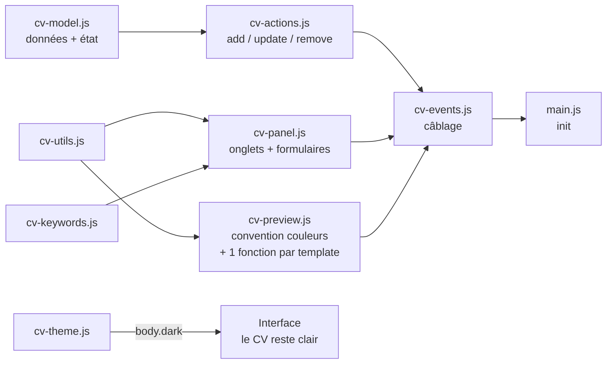

# 📝 CV-Editor

**Éditeur de CV local, autonome et compatible ATS.** Ouvrez `index.html` dans un navigateur, éditez votre CV avec aperçu en temps réel, et exportez un PDF A4 au texte sélectionnable — le format que les logiciels de tri de candidatures (ATS) lisent le mieux.

> 🎯 **100 % local &amp; privé** : aucune donnée ne quitte votre machine. Pas de backend, pas de compte, pas de tracking. Fonctionne par simple double-clic (`file://`).

> 🌐 **Version en ligne** : [simon.lepetit.free.fr/CV\_Editor](http://simon.lepetit.free.fr/CV_Editor/) — même code, hébergé chez Free. Le dépôt GitHub reste la version de référence.

---

## ✨ Fonctionnalités

### Édition &amp; aperçu

- **Aperçu live** — le CV se met à jour à chaque frappe
- **7 onglets d'édition** : Profil (avec adresse postale structurée), Expériences, Compétences, Soft-Skills, Autres Informations, Personnalisation, Poste ciblé
- **Persistance automatique** — sauvegarde dans le `localStorage` à chaque modification
- **Ajout/suppression dynamiques** d'expériences, formations, compétences, liens, soft-skills et sections libres (« Autres Informations » : libellé + liste d'infos)
- **🗑 Recommencer de zéro** — bouton de remise à plat des données locales, avec confirmation (action irréversible)

### Templates &amp; personnalisation

- **Système de templates** — liste déroulante de 6 modèles : **« Classique sobre »** (mono-colonne ATS), **« Moderne »** (bandeau coloré, sections à barre latérale) et **« Minimaliste »** (CV épuré, titres soulignés d'un filet, puces colorées, filet pleine largeur en tête) sont implémentés ; les 3 autres (« Élégant serif », « Suisse grandes majuscules », « Compétences en tête ») retombent proprement sur le Classique en attendant leur implémentation
- **Convention de couleurs** — 3 couleurs de customisation au rôle identique dans tous les templates :
  
  | Couleur             | Rôle                                                                 |
  | ------------------- | -------------------------------------------------------------------- |
  | `couleurprincipale` | Textes forts (h1, intitulés, bandeau / titres de section du Moderne) |
  | `couleursecondaire` | Accents (titre du CV, filet d'en-tête, titres de section, dates)     |
  | `couleurtertiaire`  | Texte commun du CV (rarement changée)                                |
  
- **Police** : liste déroulante de 7 polices sûres pour les ATS (Arial, Helvetica, Calibri, Verdana, Tahoma, Georgia, Times New Roman), avec pile CSS et fallback
- **Taille** : slider (2–50 px), initialisé sur la valeur sauvegardée
- **Mode sombre 🌙** : bascule d'un clic, préférence sauvegardée, détection de la préférence système (`prefers-color-scheme`). Le CV reste sur fond blanc — le mode sombre ne concerne que l'interface d'édition

### Export

- **🖨 Exporter PDF (ATS)** — seul le CV est imprimé, en A4, texte sélectionnable, sans en-têtes/pieds de page du navigateur, fond blanc garanti quel que soit le thème actif
- **⬇ Export / ⬆ Import JSON** — sauvegardez et réimportez vos données de CV

### Analyse de mots-clés (onglet « Poste ciblé »)

- Collez une offre d'emploi : l'outil extrait ses mots-clés principaux (stopwords FR/EN filtrés, top 12 par fréquence)
- Chaque mot-clé est comparé au contenu de votre CV (✓ présent / ✗ absent), avec alerte récapitulative des manquants

## 🚀 Utilisation

Aucune installation nécessaire :

- **En ligne** : ouvrez directement [la version hébergée](http://simon.lepetit.free.fr/CV_Editor/).
- **En local** :
  1. Cloner le dépôt (ou télécharger les fichiers) :
    ```bash
     git clone https://github.com/LepetitPortfolio/CV-Editor.git
    ```
  2. Ouvrir `src/index.html` dans un navigateur (double-clic suffit).
  3. Éditer votre CV — tout est sauvegardé automatiquement.
  4. Exporter :
    - **🖨 Exporter PDF (ATS)** → dans la boîte de dialogue, choisir **« Enregistrer au format PDF »** ;
    - **⬇ Export JSON** → télécharge `mes-donnees-cv.json` ;
    - **⬆ Import JSON** → restaure un CV précédemment exporté.

## 🗂 Structure du projet

Le JavaScript est découpé en modules chargés via des `<script defer>` **dans l'ordre des dépendances** (de la fondation de données vers le câblage des événements). Fonctionne en `file://` sans serveur local — contrairement aux modules ES.

```
CV-Editor/
├── src/
│   ├── index.html       # Structure : topbar, onglets, aperçu + les 9 balises <script defer>
│   ├── cv-editor.css    # UI (--editor-*), styles du CV (--cv-*), mode sombre, @media print
│   ├── cv-model.js      # Données : DEFAULT_CV, CV_FONTS, CV_TEMPLATES, état global, save()
│   ├── cv-utils.js      # Utilitaires : $, esc (échappement HTML anti-XSS)
│   ├── cv-keywords.js   # Moteur de mots-clés : STOPWORDS, extractKeywords()
│   ├── cv-preview.js    # Rendu du CV : renderPreview() (convention couleurs) + 1 fonction par template
│   ├── cv-panel.js      # Formulaires : un renderXTab() par onglet, TAB_RENDERERS, switchTab(), renderPanel(), renderJdResults(), renderAll()
│   ├── cv-actions.js    # Actions JSON : addCvItem(), updateCvField(), removeCvItem()
│   ├── cv-events.js     # Câblage : listeners input/change/click, export/import/print/reset
│   ├── cv-theme.js      # Mode sombre : applyTheme(), persistance, préférence système
│   └── main.js          # Init (chargé en dernier)
├── analyse-technique-éditeur-de-cv-avec-export-pdf-compatible-ats.pdf
└── .gitattributes
```

## 🧠 Architecture

Modèle **state-first** : un objet `cv` (JSON) est l'unique source de vérité. Chaque interaction modifie cet objet, le persiste (`save()` → `localStorage`), puis relance le rendu.



### Patrons de conception utilisés

- **Table d'association (plugin pattern)** : `TAB_RENDERERS` (onglet → sous-fonction de rendu), `ADD_ACTIONS` / `REMOVE_ACTIONS` (bouton → action sur le JSON), `CV_TEMPLATES` / `CV_FONTS` (listes de configuration). Ajouter un type d'élément, un onglet ou un template = quelques lignes, sans toucher aux cascades.
- **Séparation des responsabilités** : `cv-actions.js` manipule le JSON sans connaître le DOM ; `cv-events.js` attache les listeners et orchestre `save()` + rendus ; les modules de rendu produisent du HTML pur.
- **Système de templates** : `renderPreview()` pose d'abord la **convention de couleurs commune** (variables CSS sur `#cv-preview`) et réinitialise les habillages des templates (ex. filet `border-top` du Minimaliste), puis route vers une sous-fonction par template (`PreviewClassiqueCV` n°0, `PreviewModerneCV` n°1, `PreviewMinimalisteCV` n°2) via un `switch`, avec repli sur le Classique pour les templates non implémentés.
- **Deux systèmes de couleurs étanches** : l'interface utilise `--editor-accent` (et déclinaisons), le CV utilise exclusivement `--cv-principale` / `--cv-secondaire` / `--cv-tertiaire` / `--cv-ink` — changer les couleurs du CV n'affecte jamais l'éditeur, et réciproquement.

### Points techniques notables

- **`defer` ordonné** : les scripts s'exécutent séquentiellement après le parsing, garantissant la disponibilité des définitions ; l'ordre des balises dans `index.html` documente l'architecture.
- **Délégation d'événements** : un handler `onFieldChange` sur `document` pour `input` **et** `change` (les `<select>` émettent `change`), routé via les attributs `data-bind`, `data-exp`, `data-edu`, `data-comp`, `data-softskill`, `data-autresinformations`, `data-otherlinks`, `data-remove`.
- **Routage des `data-bind` à points** : `customisation.*` et `adresse.*` sont écrits dans leurs sous-objets respectifs, via une chaîne `if / else if / else` stricte — un `data-bind` n'écrit jamais que dans une seule cible.
- **Champs multi-lignes** : les `missions` et `informations` sont stockées en tableaux (`split("\n")`) et restituées ligne par ligne ; les entrées vides sont filtrées au rendu (soft-skills, liens, sections libres).
- **Export PDF propre** : `@media print` masque l'interface mais **déshabille** `.preview-frame` au lieu de le cacher (cacher le parent du CV produirait une page blanche) ; `@page { margin: 0 }` supprime les en-têtes/pieds de page du navigateur (« 1 sur 1 », date, URL), les marges visibles étant recréées par le `padding: 12mm` du CV ; `html, body { background: #fff !important; }` garantit un fond blanc même en mode sombre ; `break-inside: avoid` empêche les coupures au milieu d'un bloc.
- **Échappement systématique (`esc`)** : toutes les valeurs saisies sont échappées avant injection.

## 📄 Modèle de données (JSON)

```json
{
  "nom": "", "titre": "", "accroche": "", "email": "", "tel": "",
  "adresse": { "ligne1": "", "ligne2": "", "codePostal": "", "ville": "", "pays": "" },
  "otherlinks": [{ "libelle": "GitHub", "url": "..." }],
  "experiences": [{
    "poste": "", "entreprise": "", "lieu": "",
    "debut": "MM/AAAA", "fin": "MM/AAAA",
    "missions": ["une mission par ligne"]
  }],
  "formations": [{ "intitule": "", "lieu": "", "annee": "" }],
  "competences": [{ "intitule": "", "valeur": "Unity, Unreal..." }],
  "softskill": [{ "libelle": "", "desc": "" }],
  "autresinformations": [{ "libelle": "Langues", "informations": ["une info par ligne"] }],
  "customisation": {
    "Template": 0,
    "police": "Arial, sans-serif",
    "taille": "12pt",
    "couleurprincipale": "#000000",
    "couleursecondaire": "#000000",
    "couleurtertiaire": "#000000"
  }
}
```

## 🛠 Technologies

- **HTML5 / CSS3** : variables CSS (convention `--editor-*` / `--cv-*`), flexbox, `@media print`, `@page`, `calc()`, `accent-color`
- **JavaScript vanilla** (ES2020+ : `structuredClone`, optional chaining `?.`, délégation d'événements)
- **APIs navigateur** : `localStorage`, `FileReader`, `Blob`/`URL.createObjectURL`, `window.print()`, `matchMedia`, `dataset`

Aucune dépendance externe, aucun outil de build.

## ⚠️ Limitations &amp; problèmes connus

- **Templates 3 à 5 non implémentés** : le rendu retombe sur le template Classique (le choix reste mémorisé dans le JSON et visible dans le select).
- **Variable `accent` résiduelle (JS)** : `cv-model.js` déclare toujours `let accent = cv.customisation.accent || "#000000"` (clé inexistante → toujours `#000000`) et `cv-events.js` conserve un bloc de clic `.swatch` sans effet — les pastilles n'existent plus dans l'UI ni dans le CSS. Code mort à supprimer des deux fichiers.
- **Bandeau du Moderne dans les marges** : le bandeau coloré s'arrête aux limites de `.cv-page` (padding blanc autour) — choix volontaire pour rester propre à l'impression, mais un bandeau pleine largeur demanderait des marges négatives.
- **Libellé du slider** : la valeur affichée (« N px ») est correcte à l'ouverture de l'onglet mais ne se rafraîchit pas en direct pendant le glissement.
- **CV multi-pages** : le `padding` du CV ne se répète pas aux sauts de page (contenu proche du bord en page 2+).
- **Analyse de mots-clés basique** (fréquence) : pas de synonymes ni de racinisation (stemming).
- **Données liées au navigateur** (localStorage) : pensez à l'export JSON pour sauvegarder.

## 🗺 Améliorations possibles

- Implémenter les templates 3 à 5 (le routage par `switch` et la convention couleurs sont déjà en place)
- Supprimer la variable `accent` et le bloc `.swatch` restants (fin de ménage)
- Rafraîchir en direct le libellé « N px » pendant le glissement du slider
- Choix de l'ordre des sections et masquage de sections optionnelles
- Fusion profonde (deep merge) lors de l'import JSON partiel + validation de la forme (rejeter tableaux/null)
- Migration progressive vers les modules ES si un jour un serveur local ne fait pas peur (le découpage actuel est déjà « module-ready »)

## 🔗 Liens

- 🌐 **Version en ligne** : [simon.lepetit.free.fr/CV\_Editor](http://simon.lepetit.free.fr/CV_Editor/)
---

*Made with vanilla HTML/CSS/JS — no framework was harmed in the making of this tool.*