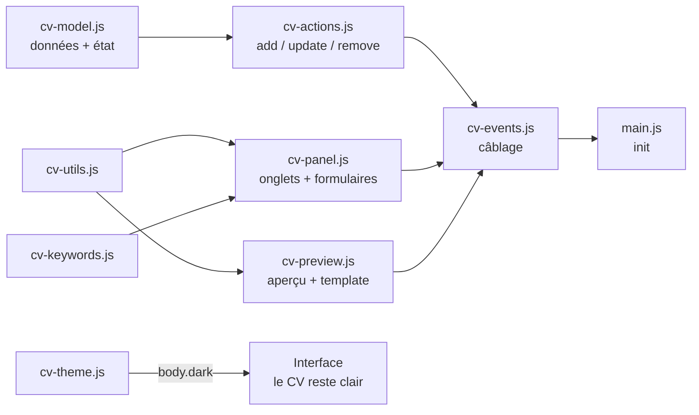

# 📝 CV-Editor

**Éditeur de CV local, autonome et compatible ATS.** Ouvrez `index.html` dans un navigateur, éditez votre CV avec aperçu en temps réel, et exportez un PDF A4 au texte sélectionnable — le format que les logiciels de tri de candidatures (ATS) lisent le mieux.

> 🎯 **100 % local & privé** : aucune donnée ne quitte votre machine. Pas de backend, pas de compte, pas de tracking. Fonctionne par simple double-clic (`file://`).

---

## ✨ Fonctionnalités

### Édition & aperçu
- **Aperçu live** — le CV se met à jour à chaque frappe, template mono-colonne lisible par les ATS
- **7 onglets d'édition** : Profil (avec adresse postale structurée), Expériences, Compétences, Soft-Skills, Autres Informations, Personnalisation, Poste ciblé
- **Persistance automatique** — sauvegarde dans le `localStorage` à chaque modification
- **Ajout/suppression dynamiques** d'expériences, formations, compétences, liens, soft-skills et sections libres (« Autres Informations » : libellé + liste d'infos)
- **🗑 Recommencer de zéro** — bouton de remise à plat des données locales, avec confirmation (action irréversible)

### Personnalisation
- **Templates** — liste déroulante de 6 modèles de mise en page (« Classique sobre », « Moderne », « Timeline minimaliste », « Élégant serif », « Suisse grandes majuscules », « Compétences en tête »). *Seul le template 0 « Classique sobre » est implémenté pour l'instant*
- **Police** : liste déroulante de polices sûres pour les ATS (Arial, Calibri, Georgia, Times New Roman…), avec pile CSS et fallback
- **Taille** : slider (2–50 px) avec valeur affichée en direct
- **3 couleurs** : principale (texte), secondaire (texte fort + accent du CV), tertiaire
- **Mode sombre 🌙** : bascule d'un clic, préférence sauvegardée, détection de la préférence système (`prefers-color-scheme`). Le CV reste sur fond blanc — le mode sombre ne concerne que l'interface d'édition

### Export
- **🖨 Exporter PDF (ATS)** — seul le CV est imprimé, en A4, texte sélectionnable, sans en-têtes/pieds de page du navigateur, fond blanc garanti quel que soit le thème actif
- **⬇ Export / ⬆ Import JSON** — sauvegardez et réimportez vos données de CV

### Analyse de mots-clés (onglet « Poste ciblé »)
- Collez une offre d'emploi : l'outil extrait ses mots-clés principaux (stopwords FR/EN filtrés, top 12 par fréquence)
- Chaque mot-clé est comparé au contenu de votre CV (✓ présent / ✗ absent), avec alerte récapitulative des manquants

## 🚀 Utilisation

Aucune installation nécessaire :

1. Cloner le dépôt (ou télécharger les fichiers) :
   ```bash
   git clone https://github.com/LepetitPortfolio/CV-Editor.git
   ```
2. Ouvrir `src/index.html` dans un navigateur (double-clic suffit).
3. Éditer votre CV — tout est sauvegardé automatiquement.
4. Exporter :
   - **🖨 Exporter PDF (ATS)** → dans la boîte de dialogue, choisir **« Enregistrer au format PDF »** ;
   - **⬇ Export JSON** → télécharge `mes-donnees-cv.json` ;
   - **⬆ Import JSON** → restaure un CV précédemment exporté.

## 🗂 Structure du projet

Le JavaScript est découpé en modules chargés via des `<script defer>` **dans l'ordre des dépendances** (de la fondation de données vers le câblage des événements). Fonctionne en `file://` sans serveur local — contrairement aux modules ES.

```
CV-Editor/
├── src/
│   ├── index.html       # Structure : topbar, onglets, aperçu + les 9 balises <script defer>
│   ├── cv-editor.css    # UI, styles du CV, mode sombre, règles d'impression (@media print)
│   ├── cv-model.js      # Données : DEFAULT_CV, CV_FONTS, CV_TEMPLATES, état global, save()
│   ├── cv-utils.js      # Utilitaires : $, esc (échappement HTML anti-XSS)
│   ├── cv-keywords.js   # Moteur de mots-clés : STOPWORDS, extractKeywords()
│   ├── cv-preview.js    # Rendu du CV : renderPreview() + un sous-fonction par template
│   ├── cv-panel.js      # Formulaires : un renderXTab() par onglet, TAB_RENDERERS, switchTab(), renderPanel(), renderJdResults(), renderAll()
│   ├── cv-actions.js    # Actions JSON : addCvItem(), updateCvField(), removeCvItem()
│   ├── cv-events.js     # Câblage : listeners input/change/click, export/import/print/reset
│   ├── cv-theme.js      # Mode sombre : applyTheme(), persistance, préférence système
│   └── main.js          # Init (chargé en dernier)
├── analyse-technique-éditeur-de-cv-avec-export-pdf-compatible-ats.pdf
└── .gitattributes
```

## 🧠 Architecture

Modèle **state-first** : un objet `cv` (JSON) est l'unique source de vérité. Chaque interaction modifie cet objet, le persiste (`save()` → `localStorage`), puis relance le rendu.



### Patrons de conception utilisés

- **Table d'association (plugin pattern)** : `TAB_RENDERERS` (onglet → sous-fonction de rendu), `ADD_ACTIONS` / `REMOVE_ACTIONS` (bouton → action sur le JSON). Ajouter un type d'élément ou un onglet = 2 lignes, sans toucher aux cascades.
- **Séparation des responsabilités** : `cv-actions.js` manipule le JSON sans connaître le DOM ; `cv-events.js` attache les listeners et orchestre `save()` + rendus ; les modules de rendu produisent du HTML pur.
- **Système de templates** : `renderPreview()` route vers une sous-fonction par template (`PreviewClassiqueCV` pour le n°0) via un `switch` — les couleurs et variables CSS sont posées en style inline sur `#cv-preview`, donc visibles aussi à l'impression.

### Points techniques notables

- **`defer` ordonné** : les scripts s'exécutent séquentiellement après le parsing, garantissant la disponibilité des définitions ; l'ordre des balises dans `index.html` documente l'architecture.
- **Délégation d'événements** : un handler `onFieldChange` sur `document` pour `input` **et** `change` (les `<select>` émettent `change`), routé via les attributs `data-bind`, `data-exp`, `data-edu`, `data-comp`, `data-softskill`, `data-autresinformations`, `data-otherlinks`, `data-remove`.
- **Routage des `data-bind` à points** : `customisation.*` et `adresse.*` sont écrits dans leurs sous-objets respectifs.
- **Champs multi-lignes** : les `missions` et `informations` sont stockées en tableaux (`split("\n")`) et restituées ligne par ligne.
- **Export PDF propre** : `@media print` masque l'interface mais **déshabille** `.preview-frame` au lieu de le cacher (cacher le parent du CV produirait une page blanche) ; `@page { margin: 0 }` supprime les en-têtes/pieds de page du navigateur (« 1 sur 1 », date, URL), les marges visibles étant recréées par le `padding: 12mm` du CV ; `html, body { background: #fff !important; }` garantit un fond blanc même en mode sombre ; `break-inside: avoid` empêche les coupures au milieu d'un bloc.
- **Échappement systématique (`esc`)** : toutes les valeurs saisies sont échappées avant injection.

## 📄 Modèle de données (JSON)

```json
{
  "nom": "", "titre": "", "accroche": "", "email": "", "tel": "",
  "adresse": { "ligne1": "", "ligne2": "", "codePostal": "", "ville": "", "pays": "" },
  "otherlinks": [{ "libelle": "GitHub", "url": "..." }],
  "experiences": [{
    "poste": "", "entreprise": "", "lieu": "",
    "debut": "MM/AAAA", "fin": "MM/AAAA",
    "missions": ["une mission par ligne"]
  }],
  "formations": [{ "intitule": "", "lieu": "", "annee": "" }],
  "competences": [{ "intitule": "", "valeur": "Unity, Unreal..." }],
  "softskill": [{ "libelle": "", "desc": "" }],
  "autresinformations": [{ "libelle": "Langues", "informations": ["une info par ligne"] }],
  "customisation": {
    "Template": 0,
    "police": "Arial, Helvetica, sans-serif",
    "taille": "12",
    "couleurprincipale": "#000000",
    "couleursecondaire": "#000000",
    "couleurtertiaire": "#000000"
  }
}
```

## 🛠 Technologies

- **HTML5 / CSS3** : variables CSS, flexbox, `@media print`, `@page`, `calc()`, `accent-color`
- **JavaScript vanilla** (ES2020+ : `structuredClone`, optional chaining `?.`, délégation d'événements)
- **APIs navigateur** : `localStorage`, `FileReader`, `Blob`/`URL.createObjectURL`, `window.print()`, `matchMedia`, `dataset`

Aucune dépendance externe, aucun outil de build.

## ⚠️ Limitations & problèmes connus

- **Templates 1 à 5 non implémentés** : seuls le template 0 « Classique sobre » est rendu ; les autres affichent un message « Template non implémenté ou inconnu ».
- **Double écriture sur les champs `customisation.*`** : dans `updateCvField()`, après l'écriture dans `cv.customisation[key]`, le `else` final exécute aussi `cv["customisation.police"] = ...` — une clé parasite est créée à la racine de l'objet. Correctif : encadrer le `if (customisation.)` avec un `else if (adresse.) ... else` correctement chaînés.
- **Cas d'un `switch` jamais atteints** : les `case "CouleurPrincipale"` / `"CouleurSecondaire"` / `"Couleurtertiaire"` (majuscules) ne correspondent jamais aux `data-bind` réels (`couleurprincipale`, en minuscules). De plus, ils posent des styles (`--couleur-principale`… sur `body`) qu'aucune règle CSS ne lit.
- **Variable `accent` vestigiale** : `cv.customisation.accent` n'existe plus dans le modèle — `accent` vaut toujours `"#000000"` ; la couleur d'accent réelle du CV est `couleursecondaire`, appliquée par `PreviewClassiqueCV()`.
- **Section soft-skill vide** : une soft-skill non renseignée affiche quand même « Libellé : Description » dans le CV — filtrer les entrées vides dans le rendu.
- **Classe `.cv-Link-line` non stylée** : le rendu la génère mais la CSS ne la définit pas (héritage du parent `.cv-contact` uniquement).
- **CV multi-pages** : le `padding` du CV ne se répète pas aux sauts de page (contenu proche du bord en page 2+).
- **Analyse de mots-clés basique** (fréquence) : pas de synonymes ni de racinisation (stemming).
- **Données liées au navigateur** (localStorage) : pensez à l'export JSON pour sauvegarder.

## 🗺 Améliorations possibles

- Implémenter les templates 1 à 5 (le système de routage par `switch` est déjà en place)
- Corriger la double écriture `customisation.*` et retirer les `case` morts du `switch`
- Filtrer les soft-skills et sections « Autres Informations » vides dans le rendu
- Choix de l'ordre des sections et masquage de sections optionnelles
- Fusion profonde (deep merge) lors de l'import JSON partiel + validation de la forme (rejeter tableaux/null)
- Migration progressive vers les modules ES si un jour un serveur local ne fait pas peur (le découpage actuel est déjà « module-ready »)


---

*Made with vanilla HTML/CSS/JS — no framework was harmed in the making of this tool.*