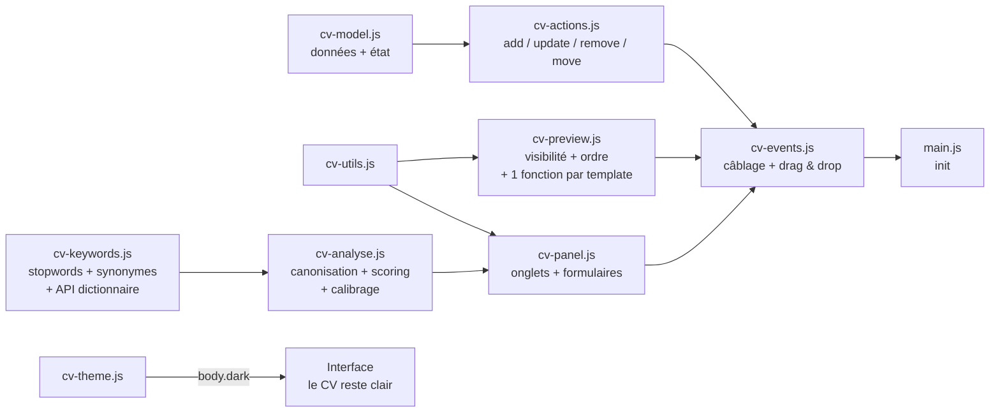

# 📝 CV-Editor

**Éditeur de CV local, autonome et compatible ATS.** Ouvrez `index.html` dans un navigateur, éditez votre CV avec aperçu en temps réel, et exportez un PDF A4 au texte sélectionnable — le format que les logiciels de tri de candidatures (ATS) lisent le mieux.

> 🎯 **100 % local &amp; privé** : aucune donnée ne quitte votre machine. Pas de backend, pas de compte, pas de tracking. Fonctionne par simple double-clic (`file://`).

> 🌐 **Version en ligne** : [simon.lepetit.free.fr/CV\_Editor](http://simon.lepetit.free.fr/CV_Editor/) — même code, hébergé chez Free. Le dépôt GitHub reste la version de référence.

---

## ✨ Fonctionnalités

### Édition &amp; aperçu

- **Aperçu live** — le CV se met à jour à chaque frappe
- **7 onglets d'édition** : Profil (avec adresse postale structurée), Expériences, Compétences, Soft-Skills, Autres Informations, Personnalisation, Analyse d'offre
- **Persistance automatique** — sauvegarde dans le `localStorage` à chaque modification
- **Ajout/suppression dynamiques** d'expériences, formations, compétences, liens, soft-skills et sections libres (« Autres Informations » : libellé + liste d'infos)
- **ℹ️ Info-bulles sur les libellés** — les explications qui encombraient les libellés (« Début (MM/AAAA) », « Missions (une par ligne) »…) vivent désormais dans une pastille ⓘ à côté du champ : au survol, ou au **focus clavier** (Tab) — donc aussi au doigt sur mobile. Composant maison 100 % CSS (`.tip` / `.tip-text`), helper `tip()` réutilisable dans cv-panel.js, variante mode sombre incluse
- **👁 Visibilité par rubrique et par entrée** — chaque rubrique (accroche, expériences, formations, compétences, soft-skills, autres informations) **et** chaque entrée individuelle (une expérience donnée, une compétence donnée, un lien donné...) possède sa case « Afficher sur le CV ». Un état masqué est repérable d'un coup d'œil (libellé rouge dans le panneau) ; une section vide ou masquée n'occupe **aucune place** dans l'aperçu ni dans le PDF. Convention : `affiche: false` = masqué, clé absente = affiché — les anciens JSON restent valides tels quels.
- **🔗 Une carte par lien** — chaque lien supplémentaire (Portfolio, GitHub, LinkedIn...) est une carte indépendante de l'onglet Profil : libellé, adresse, case de visibilité, suppression ✕, poignée de réordonnancement — même ergonomie que les autres cartes. Les URLs saisies sans schéma sont **normalisées** au rendu (`github.com/…` → `https://github.com/…` ; `http://`, `https://`, `mailto:` restent inchangés) : le lien du CV est toujours cliquable, sans double saisie. Un libellé vide n'affiche plus de « : » orphelin.
- **🧑‍💼 Profils &amp; statuts (facultatifs, cumulables)** — bloc déroulant de l'onglet Profil (interrupteur visible d'un coup d'œil, look bouton primaire) : **11 profils en 2 groupes**, chacun avec son info-bulle ⓘ « quand l'afficher — ou le taire ». *Statuts administratifs reconnus* : RQTH, OETH (obligation d'emploi), ancien militaire/vétéran, sportif de haut niveau. *Profils de parcours* : reconversion, autodidacte, jeune diplômé·e, senior (50+), diplôme obtenu à l'étranger, retour d'expatriation, pause carrière. Chaque profil coché affiche son **libellé éditable** dans le bloc contact des 6 templates (texte brut ATS-lisible, joints par « · ») ; l'ordre de cochage = l'ordre d'affichage. Stockés dans `cv.profils` (`[{ id, libelle }]`) — inclus à l'export JSON, validés à l'import (id inconnu ignoré, doublons retirés). **Migration automatique** : l'ancienne case « RQTH » (`cv.rqth` booléen) est convertie en entrée de liste au premier chargement — imports JSON anciens et `localStorage` concernés, sans code de migration dédié.
- **💬 Synthèse des soft-skills (facultative)** — champ « Synthèse » dans l'onglet Soft-Skill : une phrase introductive affichée en italique **au-dessus** de la liste des soft-skills sur les 6 templates (`softskillSynthese`, vide = rien). La section ne s'affiche que si la liste existe déjà.
- **📅 Trier par dates** — bouton de l'onglet Expériences : trie les expériences de la plus récente à la plus ancienne (champ `fin` au format MM/AAAA, vide = poste en cours = le plus récent ; dates illisibles en fin de tri). Utile après un calibrage, qui réordonne par pertinence.
- **🔀 Réordonnancement complet, à deux niveaux** :
  - **Ordre des rubriques** — liste dédiée dans l'onglet Personnalisation : poignée de glissement ⠿ **et** boutons ↑/↓, ordre commun aux 6 templates. Seules les rubriques visibles et non vides y apparaissent (celles que le CV rend réellement).
  - **Ordre des entrées** — chaque carte (expérience, formation, compétence, soft-skill, lien, autre info) embarque une toolbar en tête : poignée ⠿ + case de visibilité + boutons ↑/↓ en couleur d'accent. L'ordre est l'ordre des tableaux du JSON : il s'applique partout (aperçu, PDF, export), et le survol d'un outil illumine la carte entière.
  - Le drag &amp; drop est natif (HTML5, zéro dépendance), délégué sur `document`, et n'autorise le drop que sur les cibles du même type.
- **🗑 Recommencer de zéro** — bouton de remise à plat des données locales, avec confirmation (action irréversible)

### Templates &amp; personnalisation

- **Système de templates** — liste déroulante de **6 modèles, tous implémentés** : « Classique sobre » (mono-colonne ATS), « Moderne » (bandeau coloré, sections à barre latérale), « Timeline minimaliste » (épuré, titres soulignés, filet pleine largeur), « Élégant serif » (accents dorés, titres centrés, contact encadré), « Suisse grandes majuscules » (typographie brute, badges de section pleins) et « Compétences en tête » (étiquettes de compétences clés en haut du CV). Une valeur inconnue retombe défensivement sur le Classique. **L'ordre des sections est piloté par les données** (`customisation.ordreSections`) : chaque template construit un map de sections puis les déroule via une fonction partagée — l'ordre n'est défini qu'à un seul endroit.
- **🏷 Étiquettes de compétences clés (template « Compétences en tête »)** — champ dédié « Compétences clés » dans l'onglet Compétences : **une étiquette par ligne**, stockée dans `competencesCles` (liste de chaînes). La liste manuelle a **priorité** ; vide = étiquettes **automatiques** découpées sur les virgules des valeurs de compétences visibles (comportement historique, aucune surprise). Incluse à l'export JSON, validée à l'import (une entrée par ligne non vide). Les étiquettes suivent la visibilité de la section Compétences et l'ordre de la rubrique.
- **Convention de couleurs** — 3 couleurs de customisation au rôle identique dans tous les templates :
  
  | Couleur             | Rôle                                                                                                        |
  | ------------------- | ----------------------------------------------------------------------------------------------------------- |
  | `couleurprincipale` | Identité (nom, titre du poste, titres de section) + décorations (filets, bordures, puces, badges, bandeaux) |
  | `couleursecondaire` | Mots clés scannables (intitulés de poste, entreprises, libellés de compétences, étiquettes) + dates         |
  | `couleurtertiaire`  | Texte commun du CV (rarement changée, dérivée en `--cv-ink`)                                                |
  
- **🌗 Contraste automatique du texte sur les couleurs** — un jaune vif ou un rose pâle en couleur principale rendait le texte blanc du bandeau (Moderne) et des badges (Suisse) illisible. Désormais `texteSur()` calcule une **luminance perceptuelle** (moyenne RGB pondérée : l'œil est \~2× plus sensible au vert) : au-dessus de 75 % de 255, le texte posé sur la couleur passe en **noir** automatiquement. Même traitement pour l'**accent de l'éditeur** : les 6 zones à fond accentué (boutons primaires, logo, « + Ajouter… », flèches ↑/↓ au survol, interrupteur « Profils &amp; statuts », badges de score du calibrage) suivent la même règle. Les couleurs foncées habituelles ne changent pas d'un pixel.
- **Police** : liste déroulante de 7 polices sûres pour les ATS (Arial, Helvetica, Calibri, Verdana, Tahoma, Georgia, Times New Roman), avec pile CSS et fallback. Stockée en **index numérique** (0–6) dans le JSON, avec **migration automatique** des anciennes données au chargement
- **Taille** : slider (2–50 px), initialisé sur la valeur sauvegardée, **libellé « N px » rafraîchi en direct** pendant le glissement. Les titres et méta des 6 templates sont scalés via `calc(… * var(--cv-size))` : la typographie suit le slider de bout en bout
- **📏 Espacement du CV** : slider **0–200 %** (pas de 5), libellé « N % » en direct, appliqué via la variable CSS `--cv-gap` posée sur `#cv-preview`. **100 % = rendu d'origine des templates au pixel près** ; en dessous, le CV se compacte ; au-dessus, il s'aère. Le curseur pilote la densité verticale **complète** : marges entre les sections **et** à l'intérieur (titres h2/h3, méta de poste, listes, lignes de compétences, étiquettes) — \~30 marges des 6 templates sont converties en `calc(Npx * var(--cv-gap, 1))`. Persisté dans `customisation.espacement` (nombre, absent = 100)
- **🔗 Liens par ligne** : choisir la répartition des liens du bloc contact — tout sur une ligne, ou 1 / 2 / 3 liens par ligne (`customisation.liensParLigne`, 0 = une seule ligne). Séparateur « · » à l'intérieur d'un groupe, retour à la ligne entre les groupes — sur les 6 templates, avec le même helper partagé
- **Mode sombre 🌙** : bascule d'un clic, préférence sauvegardée, détection de la préférence système (`prefers-color-scheme`). Le CV reste sur fond blanc — le mode sombre ne concerne que l'interface d'édition
- **🖼 Photo de profil (facultative)** — ajout/retrait depuis l'onglet Profil. L'image est **redimensionnée automatiquement** (300 px de large max, JPEG qualité 0.85) pour tenir dans le `localStorage` (\~5 Mo) : même une photo de 4 Mo passe. Affichée sur **les 6 templates** avec une forme adaptée à chacun, incluse dans l'export JSON.
- **🎛 Réglages photo — ancrage, forme, encadrement, taille** — dans l'onglet Profil, visibles **uniquement quand une photo est présente** : position (Selon le template / À droite / À gauche / Centrée au-dessus du nom), forme (Rectangle / Arrondie / Ovale), encadrement (Aucun liseré / Filet discret / Couleur principale / Blanc) et **taille** (slider 0–160 px par pas de 2, libellé « auto / N px » en direct ; 0 = taille du template). Le défaut « Selon le template » préserve le look propre à chacun des 6 templates ; toute valeur explicite le surcharge, de façon composable. Persistés dans `customisation` (index numériques), donc inclus à l'export JSON.
- **🎨 Couleur d'accent de l'éditeur** — picker dans la barre d'actions, persisté en `localStorage`, **double-clic = retour à l'orange par défaut**. Préférence d'interface : volontairement **absente du JSON exporté**. Le texte des zones accentuées suit la règle de contraste ci-dessus (`--editor-accent-texte`).

### Export

- **🖨 Exporter PDF (ATS)** — seul le CV est imprimé, en A4, texte sélectionnable, sans en-têtes/pieds de page du navigateur, fond blanc garanti quel que soit le thème actif, et **couleurs de fond conservées** (`print-color-adjust: exact` — sans lui, les navigateurs suppriment les backgrounds par défaut : le bandeau du Moderne disparaissait de l'export). Le titre du document est posé à « **CV - Nom - Titre** » juste avant l'impression : le PDF proposé s'appelle `CV - Nom - Titre.pdf` et ses métadonnées restent propres pour les ATS (titre de l'éditeur restauré après)
- **📄 Multi-pages propre** — `box-decoration-break: clone` redessine le padding du CV sur **chaque page imprimée** : le contenu des pages 2+ ne colle plus aux bords, sans toucher à `@page { margin: 0 }` (les en-têtes/pieds du navigateur restent supprimés). Navigateur sans support : comportement inchangé, sans régression
- **⬇ Export / ⬆ Import JSON** — sauvegardez et réimportez vos données de CV. L'import (comme le chargement initial) utilise une **fusion profonde** (`deepMerge`) : un JSON partiel complète les valeurs par défaut au lieu d'écraser des sections entières. Les clés récentes (`affiche*`, `ordreSections`, `photoTaille`, `affiche` par entrée, `softskillSynthese`, `espacement`, `liensParLigne`, `competencesCles`, `synonymes`, `profils`) sont optionnelles : un export plus ancien s'importe sans perte ni section masquée par accident. Deux attentions à l'import des clés riches : les **synonymes importés sont complétés par les groupes par défaut du fichier** (fusion mot à mot, doublons inter-groupes retirés et signalés), et l'ancienne clé `rqth: true` est **convertie** en profil cochée (migration silencieuse).
- **🛡 Validation d'import légère** — `validerCv()` nettoie le JSON **avant** la fusion : les types inattendus (`null` dans une liste, objet dans un champ texte, tableau où un objet est attendu…) sont ignorés et remplacés par les défauts, jamais recopiés en silence ; l'import **signale ses ajustements** au lieu de bloquer. Tolérante : un nombre là où un texte est attendu est converti (une année `2020` reste lisible), les clés inconnues/absentes passent telles quelles. `synonymes` (fusion + dédoublonnage) et `profils` (id du catalogue, doublons) y sont validés avec le même esprit. Le chargement du `localStorage` passe par le même garde-fou, en silencieux.

### Analyse d'offre (onglet « Analyse d'offre »)

- Collez une offre d'emploi : l'outil extrait ses mots-clés principaux (stopwords FR/EN filtrés, top 12 par fréquence), les compare au contenu de votre CV (✓ présent / ✗ absent), avec alerte récapitulative des manquants
- **🧩 Correspondance approchée (synonymes + racines)** — l'offre **et** le CV passent par `canoniserMot()` : le dictionnaire de synonymes d'abord, puis une racinisation légère FR/EN (pluriels et suffixes courants, avec garde-fou de longueur). « Unity3D » dans le CV valide « unity » dans l'offre ; les badges ✓/✗, la pondération et le calibrage partagent le même espace de comparaison — et fini les faux positifs par sous-chaîne (« disunity » ne matche plus « unity »). **Les données du moteur (stopwords, groupes de synonymes, suffixes) vivent dans cv-keywords.js ; les algorithmes (`stem()`, `canoniserMot()`, scoring) dans cv-analyse.js** — données et code séparés.
- **🧩 Dictionnaire de synonymes éditable** — panneau repliable de l'onglet Analyse : **14 groupes transversaux FR/EN par défaut** (télétravail/remote, anglais/english, équipe/collaboration… — aucun métier privilégié), puis vos groupes spécialisés. Création d'un groupe par mots séparés par des virgules, ✕ par mot, champ « + mot » par groupe, suppression de groupe, banc d'essai « 🧪 Ça matche quoi ? » qui montre la canonisation en direct. La sélection vit dans `cv.synonymes` (clé racine du JSON) : **exportée/importée avec le CV**, elle vous suit d'une machine à l'autre ; à l'import, elle est **complétée par les défauts du fichier** (fusion + dédoublonnage). « ↺ Défauts » supprime la clé : les groupes du fichier reprennent la main.
- **🎯 Calibrage du CV** — un clic sur « Calibrer » adapte le CV à l'offre **sans jamais supprimer de contenu** (tout est réversible) : les entrées sont **notées par recouvrement de mots-clés** avec une pondération par rubrique (l'accroche pèse plus lourd qu'une mission, etc.) ; les expériences, compétences, formations et soft-skills peu pertinents sont simplement **masqués** (`affiche: false`), les mieux notés remontent en tête. Si plus de trois expériences correspondent, seules les **3 mieux notées** sont conservées (récence en départage) ; le rapport indique les entrées écartées. Le calibrage **tient compte du dictionnaire édité** : la table des synonymes est reconstruite après chaque édition.
- **📸 Snapshot réversible** — le calibrage photographie l'état du CV avant modification ; « Annuler le calibrage » restaure tout (visibilités et ordres compris)
- **📅 Trier par dates** — après un calibrage (qui trie par pertinence), le bouton de l'onglet Expériences rétablit la convention recruteur/ATS : plus récente en premier
- 💡 Les bascules de visibilité et l'ordre étant **des données** (pas des sélections), le calibrage n'écrit que `ordreSections` et des `affiche: false` — le contenu reste intégral dans l'export JSON

## 🚀 Utilisation

Aucune installation nécessaire :

- **En ligne** : ouvrez directement [la version hébergée](http://simon.lepetit.free.fr/CV_Editor/).
- **En local** :
  1. Cloner le dépôt (ou télécharger les fichiers) :
    ```bash
     git clone https://github.com/LepetitPortfolio/CV-Editor.git
    ```
  2. Ouvrir `src/index.html` dans un navigateur (double-clic suffit).
  3. Éditer votre CV — tout est sauvegardé automatiquement.
  4. Exporter :
    - **🖨 Exporter PDF (ATS)** → dans la boîte de dialogue, choisir **« Enregistrer au format PDF »** ;
    - **⬇ Export JSON** → télécharge `mes-donnees-cv.json` ;
    - **⬆ Import JSON** → restaure un CV précédemment exporté.

## 🗂 Structure du projet

Le JavaScript est découpé en modules chargés via des `<script defer>` **dans l'ordre des dépendances** (de la fondation de données vers le câblage des événements). Fonctionne en `file://` sans serveur local — contrairement aux modules ES. Les styles sont découpés de la même façon : un dossier `src/css/` par domaine (interface, un fichier par template, photo, impression, analyse), chargés dans l'ordre du fichier original pour une cascade identique.

```
CV-Editor/
├── src/
│   ├── index.html       # Structure : topbar, onglets, aperçu + les 10 balises <script defer> et les 11 <link>
│   ├── css/
│   │   ├── cv-editor-core.css              # Base UI : variables --editor-*, topbar, boutons, layout, onglets
│   │   ├── cv-editor-forms.css             # Formulaires : cartes, champs, toggles, réordonnancement, info-bulles (.tip), dictionnaire de synonymes, bloc profils
│   │   ├── cv-editor-print.css             # @media print + mode sombre
│   │   ├── cv-template-classique.css       # Template 0 « Classique » (ATS)
│   │   ├── cv-template-moderne.css         # Template 1 « Moderne » (tm-*)
│   │   ├── cv-template-minimaliste.css      # Template 2 « Minimaliste » (mn-*)
│   │   ├── cv-template-elegant.css          # Template 3 « Élégant serif » (es-*)
│   │   ├── cv-template-suisse.css           # Template 4 « Suisse » (su-*)
│   │   ├── cv-template-competences.css      # Template 5 « Compétences en tête » (ch-*)
│   │   ├── cv-photo.css                    # Photo de profil (.cv-photo + variantes par template)
│   │   └── cv-analyse.css                  # Calibrage & rapport (.calibre-*) + dictionnaire de synonymes (.syn-*)
│   ├── cv-model.js      # Données : DEFAULT_CV, CV_FONTS, CV_TEMPLATES, CV_PHOTO_*, SECTION_KEYS/LABELS, catalogue PROFILS (profils & statuts) + basculerProfil(), ordreSectionsEffectif(), deepMerge(), validerCv() (validation + fusion synonymes + migration RQTH), état global, save()
│   ├── cv-utils.js      # Utilitaires : $, esc (échappement anti-XSS), resizePhoto(), texteSur() (contraste texte/fond)
│   ├── cv-keywords.js   # Moteur de mots-clés — DONNÉES : STOPWORDS, GROUPES_SYNONYMES (14 groupes transversaux), SUFFIXES (racinisation), extractKeywords() + API du dictionnaire éditable (groupesSynonymesEffectifs, ajouter/retirer groupe ou mot, réinitialiser)
│   ├── cv-analyse.js    # Analyse d'offre — ALGORITHMES : stem(), canoniserMot(), rafraichirSynonymes() (table reconstruite après édition), scoring pondéré par rubrique, calibrage (masquage réversible, top 3), snapshot/annulation, recenceExperience()
│   ├── cv-preview.js    # Rendu du CV : renderPreview(), rubriqueVisible()/rubrique() (visibilité), sectionsOrdonnees() (ordre), normaliserUrl()/lienSupplementaire()/joindreLiens() (liens), mentionProfils() (profils & statuts), texteSur() → --cv-texte-principale + 1 fonction par template
│   ├── cv-panel.js      # Formulaires : un renderXTab() par onglet, rubriqueToggle()/itemTools() (toggles + ↑/↓ + poignée), tip() (info-bulles ⓘ), renderDictionnaireSynonymes(), renderProfilsAtypiques(), liste d'ordre des rubriques, renderJdResults(), renderAll()
│   ├── cv-actions.js    # Actions JSON : updateCvField() répartiteur + write*(), addCvItem(), removeCvItem(), moveCvItem(), moveSection(), trierExperiencesChrono()
│   ├── cv-events.js     # Câblage : listeners input/change/click, boutons ↑/↓, libellés live des sliders, branches dictionnaire/profils (avec état ouvert des <details> conservé), drag & drop délégué, export/import/print/reset
│   ├── cv-theme.js      # Thème & couleurs : applyTheme() (mode sombre), applyEditorAccent() (accent UI + --editor-accent-texte), persistance
│   └── main.js          # Init (chargé en dernier)
├── analyse-technique-éditeur-de-cv-avec-export-pdf-compatible-ats.pdf
└── .gitattributes
```

> 💡 `src/CV_Editor.html` est une simple redirection vers `index.html` (compatibilité anciens liens de la version hébergée).

## 🧠 Architecture

Modèle **state-first** : un objet `cv` (JSON) est l'unique source de vérité. Chaque interaction modifie cet objet, le persiste (`save()` → `localStorage`), puis relance le rendu.



### Patrons de conception utilisés

- **Table d'association (plugin pattern)** : `TAB_RENDERERS` (onglet → sous-fonction de rendu), `ADD_ACTIONS` / `REMOVE_ACTIONS` (bouton → action sur le JSON), `LIST_TARGETS` (attribut → collection du modèle), `CV_TEMPLATES` / `CV_FONTS` / `CV_PHOTO_*` (listes de configuration), `PROFILS_PAR_ID` (catalogue des profils → accès direct). Ajouter un type d'élément, un onglet ou un template = quelques lignes, sans toucher aux cascades.
- **Séparation des responsabilités** : `cv-actions.js` manipule le JSON sans connaître le DOM — `updateCvField()` n'est qu'un **répartiteur** qui délègue à une sous-fonction par partie du modèle (`writeCustomisation`, `writeAdresse`, `writeCvRoot`, `writeListItem` via la table `LIST_TARGETS`) ; `cv-events.js` attache les listeners et orchestre `save()` + rendus ; les modules de rendu produisent du HTML pur. Chaque fonction de rendu fait une seule chose : `renderPanel()` (panneau), `renderPreview()` (aperçu), `renderAll()` (orchestrateur). Même logique côté analyse : les **données** du moteur de mots-clés (cv-keywords.js) sont séparées des **algorithmes** (cv-analyse.js).
- **Système de templates** : `renderPreview()` pose d'abord la **convention de couleurs commune** (variables CSS sur `#cv-preview`), retire les habillages et surcharges de page des autres templates (classes `tpl-minimaliste`, `tpl-serif`, `photo-*`), puis route via un `switch` vers une sous-fonction par template (`PreviewClassiqueCV` n°0, `PreviewModerneCV` n°1, `PreviewMinimalisteCV` n°2, `PreviewElegantSerifCV` n°3, `PreviewSuisseCV` n°4, `PreviewCompetencesCV` n°5), avec repli défensif sur le Classique.
- **Visibilité et ordre = données, pas DOM** : `rubriqueVisible()` / `rubrique()` (côté rendu) filtrent rubriques masquées **et** entrées masquées à un seul endroit ; `sectionsOrdonnees()` déroule l'ordre choisi sur un map de sections construit par chaque template. Le panneau (`rubriqueToggle()`, `itemTools()`) et le modèle (`ordreSectionsEffectif()`) ne font que lire/écrire le JSON.
- **Deux systèmes de couleurs étanches** : l'interface utilise `--editor-accent` (et déclinaisons), le CV utilise exclusivement `--cv-principale` / `--cv-secondaire` / `--cv-tertiaire` / `--cv-ink` — changer les couleurs du CV n'affecte jamais l'éditeur, et réciproquement. Chaque couleur « de fond » possède sa **compagne de contraste** calculée par `texteSur()` : `--cv-texte-principale` (CV) et `--editor-accent-texte` (interface).

### Points techniques notables

- **`defer` ordonné** : les scripts s'exécutent séquentiellement après le parsing, garantissant la disponibilité des définitions ; l'ordre des balises dans `index.html` documente l'architecture.
- **Densité pilotée par variables CSS** : `renderPreview()` pose `--cv-size` (taille de base) et `--cv-gap` (espacement en ratio, 100 % → 1) sur `#cv-preview`. Les tailles et marges des 6 templates sont exprimées en `calc(N * var(--cv-size))` / `calc(Npx * var(--cv-gap, 1))` : les sliders « Taille » et « Espacement » contrôlent la typographie et la densité verticale **de bout en bout**, sans toucher au code des templates. À 100 % / 12 px, le rendu est identique au pixel près à celui d'origine.
- **Contraste texte/fond automatique (`texteSur()`)** : les couleurs personnalisables peuvent être pâles — un texte blanc dessus devient illisible. Le helper calcule la **luminance perceptuelle** (moyenne RGB pondérée : 0.299 R + 0.587 G + 0.114 B) et bascule le texte en noir au-dessus de 75 % de 255. La moyenne simple (R+G+B)/3 aurait laissé passer un jaune vif (#f5d020 : moyenne 162, luminance pondérée ≈ 199) pour une couleur sombre. Les couleurs compagnes sont posées au **point unique** où chaque couleur est déjà gérée : `--cv-texte-principale` dans `renderPreview()`, `--editor-accent-texte` dans `applyEditorAccent()`.
- **Dictionnaire de synonymes = données du CV** : `cv.synonymes` est une clé racine du JSON (convention des clés optionnelles : absente ou vide = les 14 groupes par défaut du fichier). À la **première modification**, les défauts sont **copiés** dans la clé — on édite ensuite sa copie ; « ↺ Défauts » **supprime** la clé, et les groupes du fichier (y compris ajoutés plus tard) reprennent la main. La table `SYNONYMES` de cv-analyse.js est **reconstruite** après chaque édition (`rafraichirSynonymes()`) : badges ✓/✗, pondération et calibrage suivent sans autre changement. À l'import, les groupes importés sont **complétés par les défauts du fichier** (un groupe qui partage un mot absorbe les autres mots du défaut, un défaut non représenté est ajouté), puis dédoublonnés inter-groupes — un export fait sur une autre machine ou avec une ancienne liste ne remplace jamais les défauts, il les prolonge.
- **Profils &amp; statuts = catalogue + sélection** : le catalogue (`PROFILS` dans cv-model.js : id stable, libellé par défaut, texte de l'info-bulle) vit dans le code ; la sélection (`cv.profils`, liste de `{ id, libelle }` dans l'ordre d'affichage) vit dans le JSON. L'ordre de cochage = l'ordre d'affichage ; un libellé vidé retombe sur celui du catalogue. La **migration RQTH** tient en trois lignes dans `validerCv()` : `rqth: true` → entrée en tête de `cv.profils`, puis `delete net.rqth` — comme le chargement `localStorage` passe par la validation, aucun état ancien n'échappe à la conversion, et la clé booléenne disparaît du JSON pour toujours.
- **Délégation d'événements anti-double** : un handler `onFieldChange` sur `document` pour `input` **et** `change`, routé via les attributs `data-bind`, `data-exp`, `data-edu`, `data-comp`, `data-softskill`, `data-autresinformations`, `data-otherlinks`, `data-remove`, `data-move-item`, `data-move-section`. Filtrage par type d'élément : les `<select>` et les cases à cocher ne traitent que `change` (leur `input` dupliqué est ignoré), les `<input type="color">` ne traitent que leurs `input` live.
- **Libellés live sans re-render** : les sliders (`Taille`, `Espacement`, photo) et le select « Liens par ligne » mettent à jour leur libellé `<span class="range-val">` directement dans le DOM — un `renderPanel()` pendant le glissement reconstruirait le `<input type="range">` et interromprait le geste.
- **Panneaux repliés qui restent ouverts** : les `<details>` du dictionnaire de synonymes et du bloc profils sont reconstruits à chaque édition — les helpers `repanelSynDico()` / `repanelProfils()` ré-impulsent leur état `open` après `renderPanel()`, sinon ils se replieraient à chaque clic (vite agaçant).
- **Checkboxes** : `updateCvField()` lit `t.checked` (la `value` d'une checkbox vaut toujours `"on"`) — le même répartiteur gère donc toggles de rubriques (`customisation.affiche*`) et d'entrées (`affiche` sur l'item, via `writeListItem`), sans code dédié.
- **Routage des `data-bind` à points** : `customisation.*` et `adresse.*` sont écrits dans leurs sous-objets respectifs via le répartiteur `updateCvField()` — un `data-bind` n'écrit jamais que dans une seule cible (retours explicites, pas de retombée). Les clés `Template`, `police`, `photoAncre`, `photoForme` et `photoCadre` sont stockées en nombre.
- **Fusion profonde à l'import et au chargement** : `deepMerge(DEFAULT_CV, incoming)` complète les clés manquantes à toutes les profondeurs (les tableaux restent ceux de l'entrant), sans jamais muter `DEFAULT_CV` (`structuredClone` à chaque niveau) ; `normalizePolice()` migre les anciens formats de police vers l'index valide. Les clés de visibilité/ordre/espacement/liens/profils/synonymes absentes d'un ancien JSON reçoivent les défauts (= tout affiché, ordre historique, 100 %, une ligne, rien coché, défauts du fichier).
- **Validation par schéma léger (`validerCv()`)** : les données importées **et** le `localStorage` passent par un nettoyage piloté par tables (`SCHEMA_CHAINES`, `SCHEMA_LISTES`, `SCHEMA_CUSTO_NUM`…) **avant** la fusion : chaque clé au type inattendu est ignorée (le défaut la remplacera) au lieu d'être recopiée — un `null` dans `experiences` ou un objet dans `customisation.Template` ne casse plus le rendu. Les types « presque bons » sont convertis (nombre → texte), les clés inconnues laissées (compatibilité future), et l'import liste les ajustements au lieu de rejeter le fichier. `competencesCles` (liste de chaînes), `synonymes` (liste de listes + fusion) et `profils` (id du catalogue) y sont validés de la même façon.
- **Correspondance approchée centralisée (`canoniserMot()`)** : l'offre et le CV sont projetés dans le même espace canonique (dictionnaire de synonymes puis racinisation légère) **avant** comptage et scoring — badges, pondération et calibrage sont donc cohérents entre eux par construction, y compris après édition du dictionnaire (table reconstruite).
- **Réordonnancement sans migration** : l'ordre des entrées **est** l'ordre des tableaux (`moveCvItem()` = double `splice` borné) ; l'ordre des rubriques vit dans `customisation.ordreSections`, normalisé à chaque usage par `ordreSectionsEffectif()` (clés inconnues ignorées, manquantes replacées à leur position par défaut) — un déplacement migre l'ordre complet à la volée.
- **Drag &amp; drop natif délégué** : seule la poignée ⠿ est `draggable` (la carte ne l'est pas — la sélection de texte dans les champs reste intacte) ; l'état du glissement est gardé en variable module (`dataTransfer` étant illisible pendant `dragover`), le survol ne surligne que les cibles du même type, et `dragend` nettoie tout (annulation comprise).
- **Champs multi-lignes** : les `missions` et `informations` sont stockées en tableaux (`split("\n")`) et restituées ligne par ligne ; les entrées vides sont filtrées au rendu (soft-skills, liens, sections libres). Le champ « Compétences clés » suit la même convention (une étiquette par ligne, `competencesCles` en liste).
- **Export PDF propre** : `@media print` masque l'interface mais **déshabille** `.preview-frame` au lieu de le cacher (cacher le parent du CV produirait une page blanche) ; `@page { margin: 0 }` supprime les en-têtes/pieds de page du navigateur, les marges visibles étant recréées par le `padding: 12mm` du CV ; `html, body { background: #fff !important; }` garantit un fond blanc même en mode sombre ; `print-color-adjust: exact` conserve les couleurs de fond (bandeau du Moderne, étiquettes) ; `break-inside: avoid` empêche les coupures au milieu d'un bloc. Le nom de fichier proposé vient d'un `document.title` temporaire « CV - Nom - Titre », restauré après impression.
- **Liens supplémentaires normalisés** : trois helpers partagés dans `cv-preview.js` — `normaliserUrl()` (préfixe `https://` si schéma absent), `lienSupplementaire()` (href reconstruit, texte affiché sans schéma pour rester sobre et extractible par les ATS, libellé en gras sans « : » orphelin) et `joindreLiens()` (répartition N par ligne : « · » intra-groupe, `<br>` inter-groupes). Les liens masqués (`affiche: false`) sont filtrés au même endroit sur les 6 templates.
- **Échappement systématique (`esc`)** : toutes les valeurs saisies sont échappées avant injection.
- **Info-bulles maison** : pastille `.tip` (ⓘ) + `.tip-text` en `position: absolute`, révélée par `:hover` **ou** `:focus` (tabindex posé par `tip()`) — accessible clavier et tactile sans JS de positionnement ; `pointer-events: none` sur la bulle pour ne pas voler le survol, `text-transform: none` pour neutraliser les libellés en majuscules, plafond 220 px pour les petits écrans, variante `body.dark` dans cv-editor-print.css.
- **Pipeline photo local** : `resizePhoto()` réduit l'image en `canvas` → **data-URL JPEG** (300 px, qualité 0.85) stockée dans `cv.photo` — aucune requête réseau, et le `localStorage` (\~5 Mo) reste souverain. L'affichage est 100 % CSS : un socle `.cv-photo` (format portrait 4:5, `object-fit: cover`, `object-position: top`) décliné par template. Absente = chaîne vide → mise en page inchangée.
- **Réglages photo par surcharge de classes** : `renderPreview()` pose des classes `photo-a*` (ancrage), `photo-f*` (forme), `photo-c*` (liseré), `photo-t1` (taille) sur `#cv-preview` — et les retire avant chaque rendu. La valeur 0 (« Selon le template ») ne pose aucune classe ; les sélecteurs de surcharge (1 id + 2 classes) sont plus spécifiques que les règles par template (1 id + 1 classe) → ils gagnent toujours, sans toucher aux styles existants.
- **Accent d'interface dynamique** : `applyEditorAccent()` pose `--editor-accent`, dérive `--editor-accent-soft` via `color-mix(in srgb, ${color} 14%, #fff)` et calcule `--editor-accent-texte` (contraste) — toute l'interface suit sans classe utilitaire. Stocké sous `cv-editor-accent`, **jamais dans le JSON du CV**.

## 📄 Modèle de données (JSON)

```json
{
  "photo": "",
  "nom": "", "titre": "", "accroche": "", "email": "", "tel": "",
  "profils": [{ "id": "rqth", "libelle": "RQTH — travailleur handicapé" }],
  "adresse": { "ligne1": "", "ligne2": "", "codePostal": "", "ville": "", "pays": "" },
  "otherlinks": [{ "libelle": "GitHub", "url": "...", "affiche": true }],
  "experiences": [{
    "poste": "", "entreprise": "", "lieu": "",
    "debut": "MM/AAAA", "fin": "MM/AAAA",
    "missions": ["une mission par ligne"],
    "affiche": true
  }],
  "formations": [{ "intitule": "", "lieu": "", "annee": "", "affiche": true }],
  "competences": [{ "intitule": "", "valeur": "Unity, Unreal...", "affiche": true }],
  "competencesCles": ["Unity3D", "C++", "une étiquette par ligne"],
  "softskill": [{ "libelle": "", "desc": "", "affiche": true }],
  "softskillSynthese": "",
  "synonymes": [["teletravail", "télétravail", "remote", "distanciel"], ["unity", "unity3d"]],
  "autresinformations": [{ "libelle": "Langues", "informations": ["une info par ligne"], "affiche": true }],
  "customisation": {
    "Template": 0,
    "police": 0,
    "taille": 12,
    "espacement": 100,
    "liensParLigne": 0,
    "photoAncre": 0,
    "photoForme": 0,
    "photoCadre": 0,
    "photoTaille": 0,
    "afficheAccroche": true,
    "afficheExperiences": true,
    "afficheFormations": true,
    "afficheCompetences": true,
    "afficheSoftskill": true,
    "afficheAutres": true,
    "ordreSections": ["Accroche", "Experiences", "Competences", "Softskill", "Formations", "Autres"],
    "couleurprincipale": "#000000",
    "couleursecondaire": "#000000",
    "couleurtertiaire": "#000000"
  }
}
```

> Toutes les clés de visibilité (`affiche`, `affiche*` de `customisation`), `photoTaille`, `softskillSynthese`, `competencesCles`, `synonymes`, `profils`, `espacement`, `liensParLigne` et `ordreSections` sont **optionnelles** : absentes = affiché / auto / vide / étiquettes automatiques / défauts du fichier / rien coché / 100 % / une ligne / ordre par défaut. Les exports antérieurs restent donc valides sans migration — y compris l'ancienne clé `rqth` (booléen), convertie automatiquement en profil cochée à l'import et au chargement.

## 🛠 Technologies

- **HTML5 / CSS3** : variables CSS (convention `--editor-*` / `--cv-*` + compagnes de contraste `--*-texte`), `calc()` avec variables (`--cv-size`, `--cv-gap`), flexbox, `@media print`, `@page`, `box-decoration-break: clone` (padding multi-pages), `accent-color`, sélecteur `:has()` (états des toggles, feedback des outils de carte), info-bulles `:hover`/`:focus` maison, `<details>`/`<summary>` stylés (dictionnaire, profils)
- **JavaScript vanilla** (ES2020+ : `structuredClone`, optional chaining `?.`, délégation d'événements, drag &amp; drop HTML5 natif)
- **APIs navigateur** : `localStorage`, `FileReader`, `Blob`/`URL.createObjectURL`, `window.print()`, `matchMedia`, `dataset`, `DataTransfer`

Aucune dépendance externe, aucun outil de build.

## ⚠️ Limitations &amp; choix assumés

- **Bandeau du Moderne dans les marges** : le bandeau coloré s'arrête aux limites de `.cv-page` (padding blanc autour) — choix volontaire pour rester propre à l'impression, mais un bandeau pleine largeur demanderait des marges négatives.
- **Étiquettes du template « Compétences en tête »** : par défaut, générées par découpe des valeurs du champ Compétences sur les virgules (les entrées masquées n'y contribuent pas). Le champ « Compétences clés » permet désormais une **liste dédiée** (une par ligne), qui a priorité. L'UI dit « étiquettes » ; les classes CSS gardent leur nom historique (`.ch-chips`) — vocabulaire interne inchangé.
- **Catalogue des profils en dur** : les 11 profils vivent dans `PROFILS` (cv-model.js) — un profil inconnu d'un JSON importé est ignoré avec une anomalie, pas créé à la volée. Ajouter un profil = une entrée dans le catalogue (id stable + libellé + info-bulle) ; la sélection, elle, voyage dans le JSON.
- **Suppression d'un groupe de synonymes par défaut non durable à l'import** : les groupes importés sont **toujours complétés** par les défauts du fichier — supprimer un groupe par défaut depuis l'UI est durable en local, mais une ré-importation d'un export le fait revenoir. Mémoriser les suppressions (clé `synonymesRetires`) est le correctif envisageable si ça gêne.
- **Contraste des couleurs : règle perceptuelle, pas WCAG** : le seuil « luminance pondérée ≥ 75 % de 255 → noir » est un compromis lisible — le vert lime pur reste un cas limite, et la méthode WCAG (meilleur taux de contraste) passerait aussi l'orange par défaut de l'éditeur en texte noir, ce qui changerait le look actuel. Le texte de corps (`couleurtertiaire`) sur fond blanc, lui, reste sous la responsabilité de l'utilisateur : un choix trop pâle est illisible (le seul « fix » serait un fond noir — gâchis d'encre à l'impression, choix refusé).
- **Validation d'import tolérante** : `validerCv()` nettoie silencieusement les types inattendus au lieu de rejeter le fichier — un JSON totalement corrompu s'importe donc « vidé puis complété par les défauts » plutôt qu'en erreur. Le contrôle de cohérence reste structurel (types), pas sémantique (contenu).
- **Multi-pages** : le padding répété sur chaque page imprimée dépend de `box-decoration-break: clone` (support navigateurs récents — Firefox, Chromium ≥ 130) ; sur un navigateur sans support, les pages 2+ restent collées aux bords, comme avant le correctif.
- **Analyse de mots-clés** : extraction par fréquence ; la correspondance approchée repose sur le dictionnaire (désormais **éditable depuis l'interface**) et une racinisation légère — pas de racinisation linguistique complète ni de détection de concepts multi-mots (« realite virtuelle » reste deux mots).
- **Drag &amp; drop souris/tactile** : le glissement suit l'API HTML5 (souris) ; sur écrans tactiles, les boutons ↑/↓ restent le chemin garanti.
- **Info-bulles** : la bulle est en `position: absolute` dans le flux du libellé — sur un écran très étroit, une bulle collée au bord droit du panneau peut dépasser (plafond 220 px). Pas de repositionnement JS : choix volontaire de simplicité.
- **Données liées au navigateur** (localStorage) : pensez à l'export JSON pour sauvegarder.
- **Photo dans le localStorage** : la photo est stockée en data-URL dans les données du CV — quelques photos volumineuses (ou un localStorage partagé avec d'autres apps) peuvent approcher la limite \~5 Mo. La réduction automatique (300 px) limite le risque.

## 🗺 Améliorations possibles

- Profils « libres » créés depuis l'interface (aujourd'hui : catalogue en dur dans cv-model.js, 4 lignes par profil)
- Mémoriser les suppressions de groupes de synonymes par défaut (clé `synonymesRetires`) pour les rendre durables à l'import
- Migration progressive vers les modules ES si un jour un serveur local ne fait plus peur (le découpage actuel est déjà « module-ready »)

---

*Made with vanilla HTML/CSS/JS — no framework was harmed in the making of this tool.*