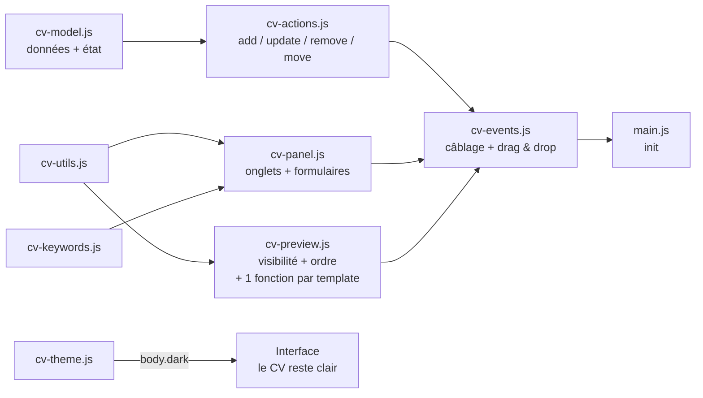

# 📝 CV-Editor

**Éditeur de CV local, autonome et compatible ATS.** Ouvrez `index.html` dans un navigateur, éditez votre CV avec aperçu en temps réel, et exportez un PDF A4 au texte sélectionnable — le format que les logiciels de tri de candidatures (ATS) lisent le mieux.

> 🎯 **100 % local & privé** : aucune donnée ne quitte votre machine. Pas de backend, pas de compte, pas de tracking. Fonctionne par simple double-clic (`file://`).

> 🌐 **Version en ligne** : [simon.lepetit.free.fr/CV_Editor](http://simon.lepetit.free.fr/CV_Editor/) — même code, hébergé chez Free. Le dépôt GitHub reste la version de référence.

---

## ✨ Fonctionnalités

### Édition & aperçu
- **Aperçu live** — le CV se met à jour à chaque frappe
- **7 onglets d'édition** : Profil (avec adresse postale structurée), Expériences, Compétences, Soft-Skills, Autres Informations, Personnalisation, Poste ciblé
- **Persistance automatique** — sauvegarde dans le `localStorage` à chaque modification
- **Ajout/suppression dynamiques** d'expériences, formations, compétences, liens, soft-skills et sections libres (« Autres Informations » : libellé + liste d'infos)
- **👁 Visibilité par rubrique et par entrée** — chaque rubrique (accroche, expériences, formations, compétences, soft-skills, autres informations) **et** chaque entrée individuelle (une expérience donnée, une compétence donnée...) possède sa case « Afficher sur le CV ». Un état masqué est repérable d'un coup d'œil (libellé rouge dans le panneau) ; une section vide ou masquée n'occupe **aucune place** dans l'aperçu ni dans le PDF. Convention : `affiche: false` = masqué, clé absente = affiché — les anciens JSON restent valides tels quels.
- **🔀 Réordonnancement complet, à deux niveaux** :
  - **Ordre des rubriques** — liste dédiée dans l'onglet Personnalisation : poignée de glissement ⠿ **et** boutons ↑/↓, ordre commun aux 6 templates. Seules les rubriques visibles et non vides y apparaissent (celles que le CV rend réellement).
  - **Ordre des entrées** — chaque carte (expérience, formation, compétence, soft-skill, autre info) embarque une toolbar en tête : poignée ⠿ + case de visibilité + boutons ↑/↓ en couleur d'accent. L'ordre est l'ordre des tableaux du JSON : il s'applique partout (aperçu, PDF, export), et le survol d'un outil illumine la carte entière.
  - Le drag & drop est natif (HTML5, zéro dépendance), délégué sur `document`, et n'autorise le drop que sur les cibles du même type.
- **🗑 Recommencer de zéro** — bouton de remise à plat des données locales, avec confirmation (action irréversible)

### Templates & personnalisation
- **Système de templates** — liste déroulante de **6 modèles, tous implémentés** : « Classique sobre » (mono-colonne ATS), « Moderne » (bandeau coloré, sections à barre latérale), « Timeline minimaliste » (épuré, titres soulignés, filet pleine largeur), « Élégant serif » (accents dorés, titres centrés, contact encadré), « Suisse grandes majuscules » (typographie brute, badges de section pleins) et « Compétences en tête » (chips de compétences clés générées automatiquement). Une valeur inconnue retombe défensivement sur le Classique. **L'ordre des sections est piloté par les données** (`customisation.ordreSections`) : chaque template construit un map de sections puis les déroule via une fonction partagée — l'ordre n'est défini qu'à un seul endroit.
- **Convention de couleurs** — 3 couleurs de customisation au rôle identique dans tous les templates :
  | Couleur | Rôle |
  |---|---|
  | `couleurprincipale` | Identité (nom, titre du poste, titres de section) + décorations (filets, bordures, puces, badges, bandeaux) |
  | `couleursecondaire` | Mots clés scannables (intitulés de poste, entreprises, libellés de compétences) + dates |
  | `couleurtertiaire` | Texte commun du CV (rarement changée, dérivée en `--cv-ink`) |

- **Police** : liste déroulante de 7 polices sûres pour les ATS (Arial, Helvetica, Calibri, Verdana, Tahoma, Georgia, Times New Roman), avec pile CSS et fallback. Stockée en **index numérique** (0–6) dans le JSON, avec **migration automatique** des anciennes données au chargement
- **Taille** : slider (2–50 px), initialisé sur la valeur sauvegardée, **libellé « N px » rafraîchi en direct** pendant le glissement
- **Mode sombre 🌙** : bascule d'un clic, préférence sauvegardée, détection de la préférence système (`prefers-color-scheme`). Le CV reste sur fond blanc — le mode sombre ne concerne que l'interface d'édition
- **🖼 Photo de profil (facultative)** — ajout/retrait depuis l'onglet Profil. L'image est **redimensionnée automatiquement** (300 px de large max, JPEG qualité 0.85) pour tenir dans le `localStorage` (~5 Mo) : même une photo de 4 Mo passe. Affichée sur **les 6 templates** avec une forme adaptée à chacun, incluse dans l'export JSON.
- **🎛 Réglages photo — ancrage, forme, encadrement, taille** — dans l'onglet Profil, visibles **uniquement quand une photo est présente** : position (Selon le template / À droite / À gauche / Centrée au-dessus du nom), forme (Rectangle / Arrondie / Ovale), encadrement (Aucun liseré / Filet discret / Couleur principale / Blanc) et **taille** (slider 0–160 px par pas de 2, libellé « auto / N px » en direct ; 0 = taille du template). Le défaut « Selon le template » préserve le look propre à chacun des 6 templates ; toute valeur explicite le surcharge, de façon composable. Persistés dans `customisation` (index numériques), donc inclus à l'export JSON.
- **🎨 Couleur d'accent de l'éditeur** — picker dans la barre d'actions, persisté en `localStorage`, **double-clic = retour à l'orange par défaut**. Préférence d'interface : volontairement **absente du JSON exporté**.

### Export
- **🖨 Exporter PDF (ATS)** — seul le CV est imprimé, en A4, texte sélectionnable, sans en-têtes/pieds de page du navigateur, fond blanc garanti quel que soit le thème actif, et **couleurs de fond conservées** (`print-color-adjust: exact` — sans lui, les navigateurs suppriment les backgrounds par défaut : le bandeau du Moderne disparaissait de l'export)
- **⬇ Export / ⬆ Import JSON** — sauvegardez et réimportez vos données de CV. L'import (comme le chargement initial) utilise une **fusion profonde** (`deepMerge`) : un JSON partiel complète les valeurs par défaut au lieu d'écraser des sections entières. Les clés récentes (`affiche*`, `ordreSections`, `photoTaille`, `affiche` par entrée) sont optionnelles : un export plus ancien s'importe sans perte ni section masquée par accident.

### Analyse de mots-clés (onglet « Poste ciblé »)
- Collez une offre d'emploi : l'outil extrait ses mots-clés principaux (stopwords FR/EN filtrés, top 12 par fréquence)
- Chaque mot-clé est comparé au contenu de votre CV (✓ présent / ✗ absent), avec alerte récapitulative des manquants
- 💡 Les bascules de visibilité et l'ordre étant **des données** (pas des sélections), un futur module « adapter mon CV à cette annonce » pourra re-prioriser le CV en écrivant simplement `ordreSections` et quelques `affiche: false` — sans jamais supprimer de contenu, de façon réversible.

## 🚀 Utilisation

Aucune installation nécessaire :

- **En ligne** : ouvrez directement [la version hébergée](http://simon.lepetit.free.fr/CV_Editor/).
- **En local** :
  1. Cloner le dépôt (ou télécharger les fichiers) :
     ```bash
     git clone https://github.com/LepetitPortfolio/CV-Editor.git
     ```
  2. Ouvrir `src/index.html` dans un navigateur (double-clic suffit).
  3. Éditer votre CV — tout est sauvegardé automatiquement.
  4. Exporter :
     - **🖨 Exporter PDF (ATS)** → dans la boîte de dialogue, choisir **« Enregistrer au format PDF »** ;
     - **⬇ Export JSON** → télécharge `mes-donnees-cv.json` ;
     - **⬆ Import JSON** → restaure un CV précédemment exporté.

## 🗂 Structure du projet

Le JavaScript est découpé en modules chargés via des `<script defer>` **dans l'ordre des dépendances** (de la fondation de données vers le câblage des événements). Fonctionne en `file://` sans serveur local — contrairement aux modules ES.

```
CV-Editor/
├── src/
│   ├── index.html       # Structure : topbar, onglets, aperçu + les 9 balises <script defer>
│   ├── cv-editor.css    # UI (--editor-*), styles du CV (--cv-*, 15 sections), toolbar des cartes, liste d'ordre, mode sombre, @media print
│   ├── cv-model.js      # Données : DEFAULT_CV, CV_FONTS, CV_TEMPLATES, CV_PHOTO_*, SECTION_KEYS/LABELS, ordreSectionsEffectif(), deepMerge(), état global, save()
│   ├── cv-utils.js      # Utilitaires : $, esc (échappement anti-XSS), resizePhoto()
│   ├── cv-keywords.js   # Moteur de mots-clés : STOPWORDS, extractKeywords()
│   ├── cv-preview.js    # Rendu du CV : renderPreview(), rubriqueVisible()/rubrique() (visibilité), sectionsOrdonnees() (ordre) + 1 fonction par template
│   ├── cv-panel.js      # Formulaires : un renderXTab() par onglet, rubriqueToggle()/itemTools() (toggles + ↑/↓ + poignée), liste d'ordre des rubriques, renderJdResults(), renderAll()
│   ├── cv-actions.js    # Actions JSON : updateCvField() répartiteur + write*(), addCvItem(), removeCvItem(), moveCvItem(), moveSection()
│   ├── cv-events.js     # Câblage : listeners input/change/click, boutons ↑/↓, drag & drop délégué, export/import/print/reset
│   ├── cv-theme.js      # Thème & couleurs : applyTheme() (mode sombre), applyEditorAccent() (accent UI), persistance
│   └── main.js          # Init (chargé en dernier)
├── analyse-technique-éditeur-de-cv-avec-export-pdf-compatible-ats.pdf
└── .gitattributes
```

## 🧠 Architecture

Modèle **state-first** : un objet `cv` (JSON) est l'unique source de vérité. Chaque interaction modifie cet objet, le persiste (`save()` → `localStorage`), puis relance le rendu.



### Patrons de conception utilisés

- **Table d'association (plugin pattern)** : `TAB_RENDERERS` (onglet → sous-fonction de rendu), `ADD_ACTIONS` / `REMOVE_ACTIONS` (bouton → action sur le JSON), `LIST_TARGETS` (attribut → collection du modèle), `CV_TEMPLATES` / `CV_FONTS` / `CV_PHOTO_*` (listes de configuration). Ajouter un type d'élément, un onglet ou un template = quelques lignes, sans toucher aux cascades.
- **Séparation des responsabilités** : `cv-actions.js` manipule le JSON sans connaître le DOM — `updateCvField()` n'est qu'un **répartiteur** qui délègue à une sous-fonction par partie du modèle (`writeCustomisation`, `writeAdresse`, `writeCvRoot`, `writeListItem` via la table `LIST_TARGETS`) ; `cv-events.js` attache les listeners et orchestre `save()` + rendus ; les modules de rendu produisent du HTML pur. Chaque fonction de rendu fait une seule chose : `renderPanel()` (panneau), `renderPreview()` (aperçu), `renderAll()` (orchestrateur).
- **Système de templates** : `renderPreview()` pose d'abord la **convention de couleurs commune** (variables CSS sur `#cv-preview`), retire les habillages et surcharges de page des autres templates (classes `tpl-minimaliste`, `tpl-serif`, `photo-*`), puis route via un `switch` vers une sous-fonction par template (`PreviewClassiqueCV` n°0, `PreviewModerneCV` n°1, `PreviewMinimalisteCV` n°2, `PreviewElegantSerifCV` n°3, `PreviewSuisseCV` n°4, `PreviewCompetencesCV` n°5), avec repli défensif sur le Classique.
- **Visibilité et ordre = données, pas DOM** : `rubriqueVisible()` / `rubrique()` (côté rendu) filtrent rubriques masquées **et** entrées masquées à un seul endroit ; `sectionsOrdonnees()` déroule l'ordre choisi sur un map de sections construit par chaque template. Le panneau (`rubriqueToggle()`, `itemTools()`) et le modèle (`ordreSectionsEffectif()`) ne font que lire/écrire le JSON.
- **Deux systèmes de couleurs étanches** : l'interface utilise `--editor-accent` (et déclinaisons), le CV utilise exclusivement `--cv-principale` / `--cv-secondaire` / `--cv-tertiaire` / `--cv-ink` — changer les couleurs du CV n'affecte jamais l'éditeur, et réciproquement.

### Points techniques notables

- **`defer` ordonné** : les scripts s'exécutent séquentiellement après le parsing, garantissant la disponibilité des définitions ; l'ordre des balises dans `index.html` documente l'architecture.
- **Délégation d'événements anti-double** : un handler `onFieldChange` sur `document` pour `input` **et** `change`, routé via les attributs `data-bind`, `data-exp`, `data-edu`, `data-comp`, `data-softskill`, `data-autresinformations`, `data-otherlinks`, `data-remove`, `data-move-item`, `data-move-section`. Filtrage par type d'élément : les `<select>` et les cases à cocher ne traitent que `change` (leur `input` dupliqué est ignoré), les `<input type="color">` ne traitent que leurs `input` live.
- **Checkboxes** : `updateCvField()` lit `t.checked` (la `value` d'une checkbox vaut toujours `"on"`) — le même répartiteur gère donc toggles de rubriques (`customisation.affiche*`) et d'entrées (`affiche` sur l'item, via `writeListItem`), sans code dédié.
- **Routage des `data-bind` à points** : `customisation.*` et `adresse.*` sont écrits dans leurs sous-objets respectifs via le répartiteur `updateCvField()` — un `data-bind` n'écrit jamais que dans une seule cible (retours explicites, pas de retombée). Les clés `Template` et `police` sont stockées en nombre.
- **Fusion profonde à l'import et au chargement** : `deepMerge(DEFAULT_CV, incoming)` complète les clés manquantes à toutes les profondeurs (les tableaux restent ceux de l'entrant), sans jamais muter `DEFAULT_CV` (`structuredClone` à chaque niveau) ; `normalizePolice()` migre les anciens formats de police vers l'index valide. Les clés de visibilité/ordre absentes d'un ancien JSON reçoivent les défauts (= tout affiché, ordre historique).
- **Réordonnancement sans migration** : l'ordre des entrées **est** l'ordre des tableaux (`moveCvItem()` = double `splice` borné) ; l'ordre des rubriques vit dans `customisation.ordreSections`, normalisé à chaque usage par `ordreSectionsEffectif()` (clés inconnues ignorées, manquantes replacées à leur position par défaut) — un déplacement migre l'ordre complet à la volée.
- **Drag & drop natif délégué** : seule la poignée ⠿ est `draggable` (la carte ne l'est pas — la sélection de texte dans les champs reste intacte) ; l'état du glissement est gardé en variable module (`dataTransfer` étant illisible pendant `dragover`), le survol ne surligne que les cibles du même type, et `dragend` nettoie tout (annulation comprise).
- **Champs multi-lignes** : les `missions` et `informations` sont stockées en tableaux (`split("\n")`) et restituées ligne par ligne ; les entrées vides sont filtrées au rendu (soft-skills, liens, sections libres).
- **Export PDF propre** : `@media print` masque l'interface mais **déshabille** `.preview-frame` au lieu de le cacher (cacher le parent du CV produirait une page blanche) ; `@page { margin: 0 }` supprime les en-têtes/pieds de page du navigateur, les marges visibles étant recréées par le `padding: 12mm` du CV ; `html, body { background: #fff !important; }` garantit un fond blanc même en mode sombre ; `print-color-adjust: exact` conserve les couleurs de fond (bandeau du Moderne, chips) ; `break-inside: avoid` empêche les coupures au milieu d'un bloc.
- **Échappement systématique (`esc`)** : toutes les valeurs saisies sont échappées avant injection.
- **Pipeline photo local** : `resizePhoto()` réduit l'image en `canvas` → **data-URL JPEG** (300 px, qualité 0.85) stockée dans `cv.photo` — aucune requête réseau, et le `localStorage` (~5 Mo) reste souverain. L'affichage est 100 % CSS : un socle `.cv-photo` (format portrait 4:5, `object-fit: cover`, `object-position: top`) décliné par template. Absente = chaîne vide → mise en page inchangée.
- **Réglages photo par surcharge de classes** : `renderPreview()` pose des classes `photo-a*` (ancrage), `photo-f*` (forme), `photo-c*` (liseré), `photo-t1` (taille) sur `#cv-preview` — et les retire avant chaque rendu. La valeur 0 (« Selon le template ») ne pose aucune classe ; les sélecteurs de surcharge (1 id + 2 classes) sont plus spécifiques que les règles par template (1 id + 1 classe) → ils gagnent toujours, sans toucher aux styles existants.
- **Accent d'interface dynamique** : `applyEditorAccent()` pose `--editor-accent` et dérive `--editor-accent-soft` via `color-mix(in srgb, ${color} 14%, #fff)` — toute l'interface suit sans classe utilitaire. Stocké sous `cv-editor-accent`, **jamais dans le JSON du CV**.

## 📄 Modèle de données (JSON)

```json
{
  "photo": "",
  "nom": "", "titre": "", "accroche": "", "email": "", "tel": "",
  "adresse": { "ligne1": "", "ligne2": "", "codePostal": "", "ville": "", "pays": "" },
  "otherlinks": [{ "libelle": "GitHub", "url": "..." }],
  "experiences": [{
    "poste": "", "entreprise": "", "lieu": "",
    "debut": "MM/AAAA", "fin": "MM/AAAA",
    "missions": ["une mission par ligne"],
    "affiche": true
  }],
  "formations": [{ "intitule": "", "lieu": "", "annee": "", "affiche": true }],
  "competences": [{ "intitule": "", "valeur": "Unity, Unreal...", "affiche": true }],
  "softskill": [{ "libelle": "", "desc": "", "affiche": true }],
  "autresinformations": [{ "libelle": "Langues", "informations": ["une info par ligne"], "affiche": true }],
  "customisation": {
    "Template": 0,
    "police": 0,
    "taille": 12,
    "photoAncre": 0,
    "photoForme": 0,
    "photoCadre": 0,
    "photoTaille": 0,
    "afficheAccroche": true,
    "afficheExperiences": true,
    "afficheFormations": true,
    "afficheCompetences": true,
    "afficheSoftskill": true,
    "afficheAutres": true,
    "ordreSections": ["Accroche", "Experiences", "Competences", "Softskill", "Formations", "Autres"],
    "couleurprincipale": "#000000",
    "couleursecondaire": "#000000",
    "couleurtertiaire": "#000000"
  }
}
```

> Toutes les clés de visibilité (`affiche`, `affiche*` de `customisation`), `photoTaille` et `ordreSections` sont **optionnelles** : absentes = affiché / auto / ordre par défaut. Les exports antérieurs restent donc valides sans migration.

## 🛠 Technologies

- **HTML5 / CSS3** : variables CSS (convention `--editor-*` / `--cv-*`), flexbox, `@media print`, `@page`, `calc()`, `accent-color`, sélecteur `:has()` (états des toggles, feedback des outils de carte)
- **JavaScript vanilla** (ES2020+ : `structuredClone`, optional chaining `?.`, délégation d'événements, drag & drop HTML5 natif)
- **APIs navigateur** : `localStorage`, `FileReader`, `Blob`/`URL.createObjectURL`, `window.print()`, `matchMedia`, `dataset`, `DataTransfer`

Aucune dépendance externe, aucun outil de build.

## ⚠️ Limitations & choix assumés

- **Bandeau du Moderne dans les marges** : le bandeau coloré s'arrête aux limites de `.cv-page` (padding blanc autour) — choix volontaire pour rester propre à l'impression, mais un bandeau pleine largeur demanderait des marges négatives.
- **Chips du template « Compétences en tête »** : générées par découpe des valeurs du champ Compétences sur les virgules (les entrées masquées n'y contribuent pas) — pas de liste de chips indépendante.
- **Validation d'import légère** : la fusion profonde complète les clés manquantes, mais un JSON au types inattendus (tableau là où un objet est attendu, valeurs `null`) n'est pas rejeté.
- **CV multi-pages** : le `padding` du CV ne se répète pas aux sauts de page (contenu proche du bord en page 2+).
- **Analyse de mots-clés basique** (fréquence) : pas de synonymes ni de racinisation (stemming).
- **Drag & drop souris/tactile** : le glissement suit l'API HTML5 (souris) ; sur écrans tactiles, les boutons ↑/↓ restent le chemin garanti.
- **Données liées au navigateur** (localStorage) : pensez à l'export JSON pour sauvegarder.
- **Photo dans le localStorage** : la photo est stockée en data-URL dans les données du CV — quelques photos volumineuses (ou un localStorage partagé avec d'autres apps) peuvent approcher la limite ~5 Mo. La réduction automatique (300 px) limite le risque.

## 🗺 Améliorations possibles

- **Adapter le CV à une annonce** : exploiter les toggles de visibilité et `ordreSections` pour re-prioriser automatiquement le CV selon les mots-clés détectés dans l'onglet « Poste ciblé » (tout est déjà en place côté modèle)
- Validation de la forme à l'import (rejeter types inattendus / `null`)
- Liste de chips indépendante pour le template « Compétences en tête » (champ dédié dans le modèle)
- Migration progressive vers les modules ES si un jour un serveur local ne fait pas peur (le découpage actuel est déjà « module-ready »)

## 🔗 Liens

- 🌐 **Version en ligne** : [simon.lepetit.free.fr/CV_Editor](http://simon.lepetit.free.fr/CV_Editor/) — même code, hébergé chez Free

---

*Made with vanilla HTML/CSS/JS — no framework was harmed in the making of this tool.*