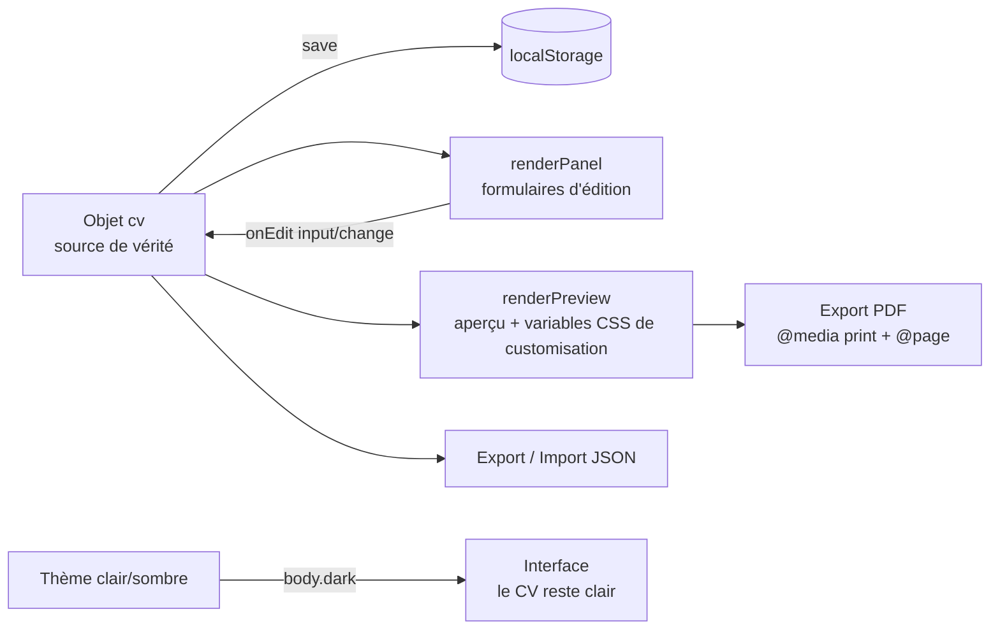

# 📝 CV-Editor

**Éditeur de CV local, autonome et compatible ATS.** Une page HTML, aucune dépendance, aucun serveur : ouvrez le fichier dans un navigateur, éditez votre CV avec aperçu en temps réel, et exportez un PDF A4 au texte sélectionnable — le format que les logiciels de tri de candidatures (ATS) lisent le mieux.

> 🎯 **100 % local & privé** : aucune donnée ne quitte votre machine. Pas de backend, pas de compte, pas de tracking.

---

## ✨ Fonctionnalités

### Édition & aperçu
- **Aperçu live** — le CV se met à jour à chaque frappe, template ATS mono-colonne
- **6 onglets d'édition** : Profil, Expériences, Compétences, Soft-Skills, Customisation, Poste ciblé
- **Persistance automatique** — sauvegarde dans le `localStorage` à chaque modification
- **Ajout/suppression dynamiques** d'expériences, formations, compétences, liens et soft-skills

### Customisation
- **Police** : liste déroulante de polices sûres pour les ATS (Arial, Calibri, Georgia, Times New Roman…), avec pile CSS et fallback
- **Taille** : slider avec valeur affichée en direct
- **Couleur du texte** et **couleur d'accent** (appliquée en temps réel à toute l'interface via la variable CSS `--accent`)
- **Mode sombre 🌙** : bascule d'un clic, préférence sauvegardée et détection de la préférence système (`prefers-color-scheme`) au premier lancement. Le CV reste sur fond blanc — le mode sombre ne concerne que l'interface d'édition

### Export
- **🖨 Export PDF (ATS)** — seul le CV est imprimé, en A4, texte sélectionnable, sans en-têtes/pieds de page du navigateur (astuce `@page { margin: 0 }` + `padding` du CV), fond blanc garanti quel que soit le thème actif
- **⬇ Export / ⬆ Import JSON** — sauvegardez et réimportez vos données de CV

### Analyse de mots-clés (onglet « Poste ciblé »)
- Collez une offre d'emploi : l'outil extrait ses mots-clés principaux (stopwords FR/EN filtrés, top 12 par fréquence)
- Chaque mot-clé est comparé au contenu de votre CV (✓ présent / ✗ absent), avec alerte récapitulative des mots-clés manquants

## 🚀 Utilisation

Aucune installation nécessaire :

1. Cloner le dépôt (ou télécharger les fichiers) :
   ```bash
   git clone https://github.com/LepetitPortfolio/CV-Editor.git
   ```
2. Ouvrir `src/CV_Editor.html` dans un navigateur (double-clic suffit).
3. Éditer votre CV — tout est sauvegardé automatiquement.
4. Exporter :
   - **🖨 Exporter PDF (ATS)** → dans la boîte de dialogue, choisir **« Enregistrer au format PDF »** (et vérifier que « En-têtes et pieds de page » est décoché, normalement déjà inutile) ;
   - **⬇ Export JSON** → télécharge `mes-donnees-cv.json` pour sauvegarder ou changer de machine ;
   - **⬆ Import JSON** → restaure un CV précédemment exporté.

## 🗂 Structure du projet

```
CV-Editor/
├── src/
│   ├── CV_Editor.html   # Structure : topbar, onglets, zone d'aperçu, boutons d'action
│   ├── CV_Editor.css    # UI + styles du CV + mode sombre + règles d'impression (@media print)
│   └── CV_Editor.js     # Logique : données, rendu, customisation, JD matching, thème
├── analyse-technique-éditeur-de-cv-avec-export-pdf-compatible-ats.pdf
└── .gitattributes
```

## 🧠 Architecture

L'application suit un modèle **state-first** : un objet `cv` (JSON) est l'unique source de vérité. Chaque interaction modifie cet objet, le persiste (`save()` → `localStorage`), puis relance le rendu (`renderPreview()` / `renderPanel()`).



### `CV_Editor.js` — les 7 sections

| # | Section | Rôle |
|---|---|---|
| 1 | Modèle de données | `DEFAULT_CV` (structure complète + customisation par défaut), `CV_FONTS` (polices ATS), chargement `localStorage` avec fusion défensive sur les défauts |
| 2 | Outils | `$` (sélecteur), `esc` (échappement HTML anti-XSS sur toutes les valeurs saisies), `save()` |
| 3 | Moteur de mots-clés | `extractKeywords(jd)` : tokenisation, stopwords FR/EN, comptage, top 12 |
| 4 | Rendu de l'aperçu | `renderPreview()` : HTML du CV + application de la customisation via variables CSS (`--cv-ink`, `--cv-size`, `--cv-font`) posées sur le conteneur |
| 5 | Rendu du formulaire | `renderPanel()` (champs par onglet, liste de polices, slider de taille) + `renderJdResults()` (comparaison mots-clés/offre ↔ CV) |
| 6 | Rendu global + événements | `renderAll()` ; handler `onEdit` (délégation `input`/`change` via attributs `data-bind`, `data-exp`, `data-edu`, `data-comp`, `data-softskill`, `data-remove`) ; handler `click` (onglets, ajouts/suppressions) ; export/import/print |
| 7 | Mode sombre | `applyTheme()` (classe `body.dark`), persistance `localStorage`, détection `prefers-color-scheme`, attachement différé (`DOMContentLoaded`, le script étant chargé en `defer` dans le `<head>`) |

### Points techniques notables

- **Chargement `defer`** : le JS est chargé dans le `<head>` avec `defer`, garantissant que le DOM existe quand les listeners s'attachent (et que `renderAll` est défini quand l'événement `DOMContentLoaded` se déclenche).
- **Délégation d'événements** : un handler `onEdit` attaché à `document` pour `input` **et** `change` (les `<select>` et sliders émettant `change`), routé via les attributs `data-*` — robuste face aux re-rendus du DOM.
- **Routage des `data-bind` à points** : `customisation.*` est écrit dans `cv.customisation[key]` (pas une clé racine), avec application immédiate de l'accent via `--accent` sur `:root`.
- **Customisation par variables CSS** : `renderPreview()` pose `--cv-ink`, `--cv-size`, `--cv-font` en style inline sur `#cv-preview` ; le CV les lit avec fallbacks. Les styles inline survivant à `@media print`, la customisation est visible aussi dans le PDF.
- **Export PDF propre** : `@media print` masque l'interface mais **déshabille** `.preview-frame` au lieu de le cacher (cacher le parent du CV produisait une page blanche) ; `@page { margin: 0 }` supprime les en-têtes/pieds de page du navigateur (« 1 sur 1 », date, URL), les marges visibles étant recréées par le `padding: 12mm` du CV ; `break-inside: avoid` empêche les coupures au milieu d'une expérience.
- **Échappement systématique (`esc`)** : toutes les valeurs saisies sont échappées avant injection dans l'aperçu.

## 📄 Modèle de données (JSON)

```json
{
  "nom": "", "titre": "", "accroche": "", "email": "", "tel": "",
  "otherlinks": [{ "libelle": "GitHub", "url": "..." }],
  "experiences": [{
    "poste": "", "entreprise": "", "lieu": "",
    "debut": "MM/AAAA", "fin": "MM/AAAA",
    "missions": ["une mission par ligne"]
  }],
  "formations": [{ "intitule": "", "lieu": "", "annee": "" }],
  "competences": [{ "intitule": "Moteurs", "valeur": "Unity, Unreal..." }],
  "softskill": [{ "libelle": "", "desc": "" }],
  "customisation": { "police": "Arial, Helvetica, sans-serif", "taille": "12", "couleur": "#000000", "accent": "#000000" }
}
```

## 🛠 Technologies

- **HTML5 / CSS3** : variables CSS, flexbox, `@media print`, `@page`, `calc()`, `accent-color`
- **JavaScript vanilla** (ES2020+ : `structuredClone`, optional chaining `?.`, délégation d'événements)
- **APIs navigateur** : `localStorage`, `FileReader`, `Blob`/`URL.createObjectURL`, `window.print()`, `matchMedia`

Aucune dépendance externe, aucun outil de build.

## ⚠️ Limitations & problèmes connus

- **Fond sombre à l'impression (mode sombre)** : `@media print` définit `body { background: #fff; }` mais `body.dark` (plus spécifique) l'emporte — en mode sombre, une bande sombre apparaît sous le CV sur le PDF. Correctif identifié : `html, body { background: #fff !important; }` dans le bloc print.
- **Section soft-skill vide** : une soft-skill non renseignée affiche quand même « Libellé : Description » dans le CV — filtrer les entrées vides dans `renderPreview()`.
- **Classe `.cv-Link-line` non stylée** : le JS génère `class="cv-Link-line"` pour les liens mais la CSS ne la définit pas (héritage du parent `.cv-contact` uniquement).
- **CV multi-pages** : le `padding` du CV ne se répète pas aux sauts de page (contenu proche du bord en page 2+) ; pour un CV d'1-2 pages, imperceptible.
- **Analyse de mots-clés basique** (fréquence) : pas de synonymes ni de racinisation (stemming).
- **Données liées au navigateur** (localStorage) : pensez à l'export JSON pour sauvegarder.

## 🗺 Améliorations possibles

- Appliquer le correctif du fond d'impression (`!important`) et le filtrage des soft-skills vides
- Choix de l'ordre des sections et masquage de sections optionnelles
- Plusieurs templates de mise en page
- Fusion profonde (deep merge) lors de l'import JSON partiel + validation de la forme (rejeter tableaux/null)
- Rafraîchissement de la couleur d'accent après import JSON

---

*Made with vanilla HTML/CSS/JS — no framework was harmed in the making of this tool.*
