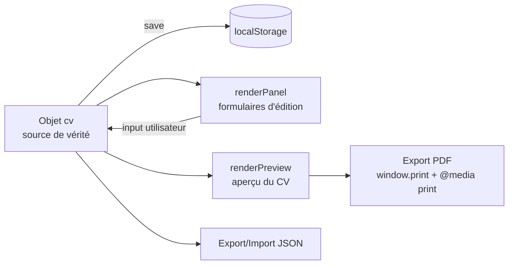

# 📝 CV-Editor

**Éditeur de CV local, autonome et compatible ATS.** Une seule page HTML, aucune dépendance, aucun serveur : ouvrez le fichier dans un navigateur, éditez votre CV, exportez-le en PDF sélectionnable ou sauvegardez vos données en JSON.

> 🎯 Conçu pour produire des CV **mono-colonne, A4, Arial, texte sélectionnable** — le format que les ATS (logiciels de tri de candidatures) lisent le mieux.

---

## ✨ Fonctionnalités

- **100 % local & privé** — aucune donnée ne quitte votre machine (pas de backend, pas de tracking, pas d'API).
- **Aperçu live** — le rendu du CV se met à jour à chaque frappe, dans un template ATS mono-colonne.
- **6 onglets d'édition** : Profil, Expériences, Compétences, Soft-Skills, Customisation, Poste ciblé.
- **Analyse de mots-clés (JD matching)** — collez une offre d'emploi : l'outil extrait ses mots-clés principaux et signale ceux absents de votre CV.
- **Export / Import JSON** — sauvegardez et réimportez vos données de CV quand vous voulez.
- **Export PDF ATS** — via `window.print()` avec des règles `@media print` dédiées (seul le CV est imprimé, mise en page A4).
- **Persistance automatique** — vos modifications sont enregistrées dans le `localStorage` du navigateur.
- **Zéro dépendance** — HTML + CSS + JavaScript vanilla, aucun framework, aucun build.

## 🚀 Utilisation

Aucune installation nécessaire :

1. Cloner le dépôt (ou télécharger les fichiers) :
   ```bash
   git clone https://github.com/LepetitPortfolio/CV-Editor.git
   ```
2. Ouvrir `src/CV_Editor.html` dans un navigateur (double-clic suffit).
3. Éditer votre CV via les onglets — tout est sauvegardé automatiquement.
4. Exporter :
   - **🖨 Exporter PDF (ATS)** → imprime uniquement le CV au format A4 (choisir « Enregistrer en PDF ») ;
   - **⬇ Export JSON** → télécharge `mes-donnees-cv.json` ;
   - **⬆ Import JSON** → restaure un CV précédemment exporté.

## 🗂 Structure du projet

```
CV-Editor/
├── src/
│   ├── CV_Editor.html   # Structure de la page : topbar, onglets, aperçu
│   ├── CV_Editor.css    # Styles UI + styles du CV + règles d'impression (@media print)
│   └── CV_Editor.js     # Logique : modèle de données, rendu, événements, export/import
├── analyse-technique-éditeur-de-cv-avec-export-pdf-compatible-ats.pdf
└── .gitattributes
```

## 🧠 Architecture & fonctionnement

L'application suit un modèle **state-first** simple : un objet `cv` (structure JSON) est l'unique source de vérité ; chaque interaction modifie cet objet, le persiste (`save()` → `localStorage`), puis relance le rendu (`renderPreview()` / `renderPanel()`).



### `CV_Editor.js` — les grands blocs

| Section | Rôle |
|---|---|
| **1. Modèle de données** | `DEFAULT_CV` : structure complète (identité, expériences, formations, compétences, soft-skills, liens, customisation) + chargement depuis le `localStorage` avec fusion sur les valeurs par défaut. |
| **2. Outils** | `$` (sélecteur), `esc` (échappement HTML anti-XSS sur toutes les valeurs saisies), `save()`. |
| **3. Moteur de mots-clés** | `extractKeywords(jd)` : tokenisation de l'offre d'emploi, filtrage des stopwords FR/EN, comptage des occurrences, top 12 mots-clés. |
| **4. Rendu de l'aperçu** | `renderPreview()` : génère le HTML du CV (sections conditionnelles, missions en listes). |
| **5. Rendu du formulaire** | `renderPanel()` : génère dynamiquement les champs de chaque onglet ; `renderJdResults()` : compare les mots-clés de l'offre au contenu du CV et affiche les manquants. |
| **6. Événements** | Délégation globale (`input` / `click` sur `document`) : binding `data-*` vers l'objet `cv`, navigation par onglets, ajout/suppression d'éléments, export/import/print. |

### Points techniques notables

- **Délégation d'événements** : un seul listener `input` et un seul listener `click` sur `document`, routés via les attributs `data-bind`, `data-exp`, `data-edu`, `data-comp`, `data-softskill`, `data-remove` — robuste face aux re-rendus du DOM.
- **Échappement systématique (`esc`)** : toutes les valeurs saisies sont échappées avant injection dans l'aperçu.
- **Impression propre** : les règles `@media print` masquent l'interface (topbar, éditeur, cadre d'aperçu) pour n'imprimer que le CV, en A4 avec marges 12 mm ; `break-inside: avoid` empêche les coupures au milieu d'une expérience.
- **Couleur d'accent dynamique** : variable CSS `--accent` mise à jour en direct.
- **Fusion défensive au chargement** : `{ ...DEFAULT_CV, ...JSON.parse(...) }` garantit la présence de tous les champs même avec un JSON importé incomplet ou ancien.

## 📄 Modèle de données (JSON)

```json
{
  "nom": "", "titre": "", "accroche": "", "email": "", "tel": "",
  "otherlinks": [{ "libelle": "GitHub", "url": "..." }],
  "experiences": [{
    "poste": "", "entreprise": "", "lieu": "",
    "debut": "MM/AAAA", "fin": "MM/AAAA",
    "missions": ["une mission par ligne"]
  }],
  "formations": [{ "intitule": "", "lieu": "", "annee": "" }],
  "competences": [{ "intitule": "Moteurs", "valeur": "Unity, Unreal..." }],
  "softskill": [{ "libelle": "", "desc": "" }],
  "customisation": { "police": "", "taille": "", "couleur": "", "accent": "" }
}
```

## ⚙️ Analyse mots-clés / onglet « Poste ciblé »

1. Collez la description du poste dans le champ dédié.
2. L'outil extrait les 12 mots-clés les plus fréquents (stopwords français et anglais filtrés, mots < 3 lettres ignorés).
3. Chaque mot-clé est comparé au contenu de votre CV :
   - ✅ **présent** dans le CV ;
   - ✗ **absent** — regroupés dans une alerte récapitulative à vérifier et ajouter si pertinent.

## 🛠 Technologies

- **HTML5 / CSS3** (variables CSS, flexbox, `@media print`, `@page`)
- **JavaScript vanilla** (ES2020+ : `structuredClone`, optional chaining, délégation d'événements)
- **localStorage**, **FileReader**, **Blob + URL.createObjectURL**, **window.print()**

Aucune dépendance externe, aucun outil de build.

## ⚠️ Limitations connues

- L'accent du CV et la police/taille définis dans l'onglet Customisation ne sont pas tous appliqués au rendu exporté (seule la couleur d'accent est réellement branchée sur `--accent`).
- Un export PDF passe par la boîte d'impression du navigateur ; l'option « En-têtes et pieds de page » doit être désactivée pour un résultat propre.
- Les données sont liées au navigateur et au profil utilisé (localStorage) : pensez à exporter en JSON pour sauvegarder.
- Analyse de mots-clés basique (fréquence) : pas de synonymes ni de racinisation (stemming).

## 🗺 Améliorations possibles

- Appliquer la police et la taille choisies au rendu du CV et au print.
- Ajout de plusieurs templates de mise en page.
- Nettoyage des `console.log` de debug.
- Choix de l'ordre des sections et masquage de sections optionnelles.

## 📜 Licence

Projet personnel — voir le dépôt GitHub pour plus de détails.

---

*Made with vanilla HTML/CSS/JS — no framework was harmed in the making of this tool.*
